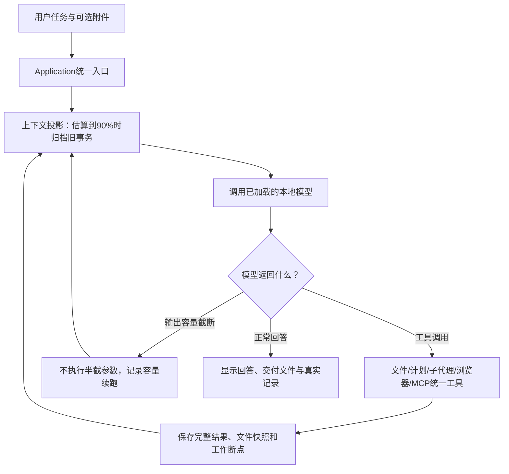

# 架构 0.1.0：文件计划、独立子代理与容量续跑

只保留红色完全控制模式。模型选择工具和执行策略；用户本轮授权了90%自动压缩、文件计划/子代理、分段编辑及容量续跑。无额外任务审批模型，完整规则见 [RULES.md](RULES.md)。

## 模块总表

| 板块 | 职责与本轮变化 |
| --- | --- |
| settings / bootstrap | 唯一配置、十五项工具装配；新增压缩比例和续跑开关 |
| core | 公共消息、事件、结果、用量、计划结构及扩展 Port；v1兼容增量 |
| application | CLI/网页唯一入口；子记录索引、修改预览、恢复、父子用量 |
| runtime.runner | 主/子共用一个模型工具循环；容量续跑、用户停止、超时和真实调用统计 |
| runtime.delegation | 模型保存文件职责/接口/依赖，串行执行独立历史子代理；不复制主历史 |
| context | 投影、6000字工具摘录、归档完整事务、固定用户原文与工作索引；无总结模型 |
| providers | 本地兼容HTTP/SSE模型，单次请求由messages决定；保持已加载模型 |
| tools | 原十一项＋file_edit/task_plan/agent_task/task_checkpoint，共十五项；统一Schema与ToolResult |
| integrations | 懒启动真实Playwright与MCP；浏览器/MCP实例主子共用，动作记录在实际执行分支 |
| storage | 完整SQLite消息/分支、写前快照、版本核对、原始附件及工作区写锁 |
| gateway / web / cli | HTTP v1/SSE；参数控件、压缩/子代理/续跑阶段、子记录下载和父子修改恢复 |
| development | 与Agent本体分开；完整任务、测试、参数实测、失败、用量、每轮图与树 |

## 总运行流程图



子代理是工具层内的一次受委派执行，同样使用Runner，但有独立消息分支；只返回简短结果给主代理。模型先列文件职责和公共接口，再决定逐项委派及整合。当前子代理单层串行，非多进程同时加载多份模型。主循环仍只有一个用户任务入口。

## 上下文与本地参数

触发占用率为（保守输入估算＋输出预留）/配置容量，不使用累计usage判断；不是精确tokenizer。归档边界只选闭合事务，固定全部用户原消息、system、当前计划与工作断点，完整原文可分页取回。工作索引不是语义完整摘要，重要旧决策可能需要取原文。必要内容本身放不下时停止。

分段追加核对UTF-8字节位置，每块完整调用独立落盘并先快照。输出截断不执行半截JSON，也不自动重放已完成外部动作；容量续跑重新提交整理后的messages，不默认卸载/重载模型。普通服务/工具/验收错误没有自动补救链。整轮超时和停止始终可用。

独立子历史降低主请求携带源码的负担，但每个子代理仍需要工具定义与用户要求，总token可能增加。本轮参数比较只覆盖当前机器/模型的少量样本，不能声称找到全局最优或保证所有复杂任务成功。

完整原始消息、模型响应、父子调用用量、动作结果、快照、旧分支均保留。父RunResult累计主子调用，未知用量是null。分支共享工作区文件，文件恢复不能撤销浏览器/MCP外部副作用。

## 完整源码与文档文件树

以下为全部受维护文件与职责，历史批次快照保持原内容。私有配置、缓存和生成现场在后面单列，不混入Agent本体。

```text
clearact-lite/
├── development/
│   ├── docs/
│   │   ├── changes/
│   │   │   ├── 2026-10-22-capabilities-tree.txt                   本轮完整逐文件职责树快照
│   │   │   ├── 2026-10-22-capabilities.md                         本轮解释图、实际验证、用量与未通过项
│   │   │   ├── 2026-10-22-foundation-tree.txt                     基础版完整文件树（历史）
│   │   │   ├── 2026-10-22-foundation.md                           基础版修改图、结果和限制（历史）
│   │   │   ├── 2026-10-22-frontend-tree.txt                       前端接入后的完整文件树（历史）
│   │   │   ├── 2026-10-22-frontend.md                             前端接入图、验证和失败（历史）
│   │   │   ├── 2026-10-22-layout-tree.txt                         归档调整后的完整文件树（历史）
│   │   │   ├── 2026-10-22-layout.md                               开发资料归档调整说明（历史）
│   │   │   ├── 2026-10-22-long-work-tree.txt                      本轮全部受维护文件与逐文件职责快照
│   │   │   └── 2026-10-22-long-work.md                            本轮修改图、参数实测、失败、证据及未通过项
│   │   ├── ARCHITECTURE.md                                        当前总流程、模块表、完整逐文件职责树及边界
│   │   ├── CONTRACTS.md                                           统一 v1 接口与本轮新增计划/子代理/容量契约
│   │   ├── RULES.md                                               实际提示、用户授权的新容量行为与保留的技术限制
│   │   └── WORKFLOW.md                                            每批修改前中后的沟通和解释图约定
│   ├── fixtures/
│   │   └── large-visual-novel.txt                                 完整原始大游戏任务文本，不含旧游戏实现
│   ├── scripts/
│   │   ├── evaluate_foundation.py                                 隔离小文件真实本地模型冒烟及用量记录
│   │   ├── evaluate_long_work.py                                  真实本地参数矩阵、累计/容量边界、诱发截断续跑及原始大任务
│   │   ├── mcp_fixture.py                                         隔离的真实 FastMCP 测试服务，三种传输与副作用样例
│   │   ├── verify_capabilities.py                                 UI/真实模型/完整大任务，保留失败及明确反馈复测
│   │   ├── verify_frontend.py                                     Edge 工作台交互、停止/恢复/分支及真实模型验收
│   │   ├── verify_launcher.py                                     真实 Windows 启动器、错误保留、就绪与清理验证
│   │   ├── verify_long_frontend.py                                真实 Edge 检查长任务参数、子记录、父子恢复（协议替身）
│   │   └── verify_long_game.py                                    独立副本中的实际鼠标/键盘路线、存读档、重开、素材和缺项验收
│   ├── tests/
│   │   ├── test_capabilities.py                                   真实三种 MCP/Edge、上传、文档和二进制恢复测试
│   │   ├── test_contract_boundary.py                              依赖方向、统一数据序列化与版本测试
│   │   ├── test_foundation.py                                     运行、分支、快照、恢复、停止与模型协议测试
│   │   ├── test_gateway.py                                        本机 HTTP、设置脱敏、停止、恢复与下载测试
│   │   └── test_long_work.py                                      压缩保真/协议、断点、追加版本、子隔离/停止和累计用量测试
│   └── README.md                                                  开发资料导航、隔离现场和历史迁移说明
├── src/
│   └── clearact_lite/
│       ├── context/
│       │   ├── __init__.py                                        context 包边界
│       │   ├── builder.py                                         带历史索引的请求投影、单一 system、估算与容量检查
│       │   └── compaction.py                                      按比例归档闭合事务、保留用户原文、构建可回溯工作索引
│       ├── core/
│       │   ├── __init__.py                                        core 包边界
│       │   ├── contracts.py                                       公共消息/工具/用量/事件与文件计划数据（HTTP DTO 见 gateway）
│       │   ├── errors.py                                          协议、容量与恢复冲突的显式异常
│       │   └── ports.py                                           统一模型、存储、浏览器、MCP 和 DelegationPort 扩展协议
│       ├── gateway/
│       │   ├── __init__.py                                        gateway 包边界
│       │   ├── contracts.py                                       HTTP v1 输入 DTO，含长任务参数默认值与校验
│       │   ├── server.py                                          本机 HTTP/SSE、上传/浏览器/MCP 路由与静态资源
│       │   └── service.py                                         活动运行、配置保存、上传限制及实时帧
│       ├── integrations/
│       │   ├── __init__.py                                        integrations 包边界
│       │   ├── browser.py                                         浏览器打开/读取/操作三个统一工具及 Schema
│       │   ├── config.py                                          三种 MCP 传输配置归一化、校验、私密值保留
│       │   └── mcp.py                                             服务/工具发现与调用两个统一工具，依赖 MCPPort
│       ├── providers/
│       │   ├── __init__.py                                        providers 包边界
│       │   └── openai_compatible.py                               本地兼容 HTTP/SSE，组装流式调用与原始响应
│       ├── runtime/
│       │   ├── __init__.py                                        runtime 包边界
│       │   ├── delegation.py                                      模型文件计划、依赖校验、独立子历史及分配文件写入边界
│       │   └── runner.py                                          主/子复用的执行循环、容量续跑、停止及父子总用量
│       ├── storage/
│       │   ├── __init__.py                                        storage 包边界
│       │   ├── lease.py                                           操作系统工作区写锁
│       │   ├── snapshots.py                                       文本/二进制写前快照、diff、哈希核对与恢复
│       │   ├── sqlite.py                                          追加事件、完整消息、历史分支和事务边界
│       │   └── uploads.py                                         原始附件 blob、独立工作副本、元信息及哈希
│       ├── tools/
│       │   ├── __init__.py                                        tools 包边界
│       │   ├── browser.py                                         浏览器打开/读取/操作三个统一工具及 Schema
│       │   ├── documents.py                                       按需提取 PDF/DOCX/XLSX/XLSM 内容与公式
│       │   ├── files.py                                           文件列表/读写/交付；带版本核对的分段追加与局部修改
│       │   ├── history.py                                         分页取回原始事件/工具参数及已委派子代理历史目录
│       │   ├── mcp.py                                             服务/工具发现与调用两个统一工具，依赖 MCPPort
│       │   ├── registry.py                                        统一工具注册、Schema 校验和异步资源释放
│       │   └── tasks.py                                           task_plan、agent_task、task_checkpoint 三个统一工具
│       ├── web/
│       │   ├── app.js                                             HTTP/SSE、压缩/续跑/子代理阶段、子修改与记录下载
│       │   ├── capabilities.js                                    上传/拖放/粘贴、MCP 编辑连接和共享浏览器操作
│       │   ├── index.html                                         工作台、MCP/浏览器/附件及长任务参数控件
│       │   └── style.css                                          响应式浅色/深色界面、附件和侧栏布局
│       ├── __init__.py                                            clearact_lite 包边界
│       ├── __main__.py                                            python -m clearact_lite 入口
│       ├── application.py                                         统一入口、容量配置、隐藏子话题、子修改预览和原分支恢复
│       ├── bootstrap.py                                           唯一装配点，十五项工具及子执行器绑定
│       ├── cli.py                                                 网页或 CLI 启动、执行、停止与记录展示
│       └── settings.py                                            唯一运行配置、90%/60% 压缩与容量续跑开关
├── .gitignore                                                     排除密钥、运行现场、缓存和构建产物
├── AGENTS.md                                                      开发约定及本轮用户明确授权的容量/子代理扩展
├── README.md                                                      安装、启动、能力用法、配置与验收入口
├── clearact.cmd                                                   双击启动工作台并打开浏览器，失败保留窗口
└── pyproject.toml                                                 十项运行依赖、静态资源打包、pytest/Ruff 配置
```

## 运行时与测试现场

```text
<所选工作区>/
├── <用户工作文件>
├── uploads/<上传ID>/<安全文件名>    可编辑工作副本
├── browser-captures/              模型截图
├── mcp-results/                   MCP 图片/音频等文件
└── .clearact/                     私有运行数据
    ├── history.sqlite3[-wal/-shm]  完整消息、事件、分支和结果
    ├── writer.lock                工作区写锁
    ├── snapshots/<sha256>         写入前原字节
    ├── uploads/blobs/<sha256>     原始上传字节
    ├── uploads/<上传ID>.json      附件元信息
    ├── browser/events.jsonl       用户和模型浏览器动作
    └── mcp/*.stderr.log           stdio 服务诊断输出

<项目>/.clearact/
├── web-settings.json              私有模型配置
└── mcp-servers.json               私有 MCP 配置

<项目>/development/
├── records/evals/<每次独立目录>/   回归、UI、真实模型、失败、用量和截图
├── records/layout-relocation-inventory.json  历史迁移原字节清单
└── .cache/                        开发工具缓存
```

运行数据和私有配置均由 Git 忽略，不自动上传。当前能力验证与尚未通过项见 [本轮说明](changes/2026-10-22-capabilities.md)，具体接口见 [CONTRACTS.md](CONTRACTS.md)。完整大任务的失败不会通过修改文档变成通过。
