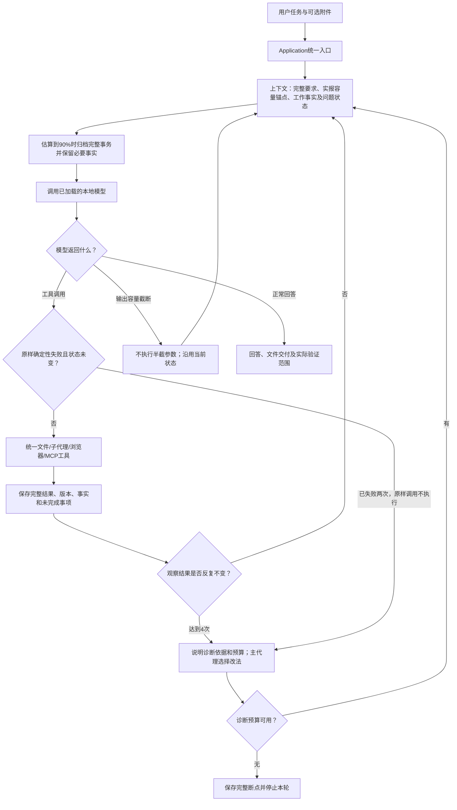

# 架构 0.1.0：工作事实、独立子代理与有界诊断

只保留红色完全控制模式。模型选择工具和执行策略；已授权90%自动压缩、文件计划/子代理、分段编辑及容量续跑。2026-10-27接入主代理按需诊断、重复错误及不变观察的有界止损。无额外任务审批模型，完整规则见 [RULES.md](RULES.md)。

## 模块总表

| 板块 | 职责与本轮变化 |
| --- | --- |
| settings / bootstrap | 唯一配置与工具装配；模型、容量与有界诊断预算 |
| core | 唯一公共消息、事件、用量、计划、ToolFact/RecoveryState、浏览器诊断与结构化交接；v1兼容 |
| application | CLI/网页唯一入口；子记录索引、修改预览、恢复、父子用量 |
| runtime.runner | 主/子统一工具循环；容量续跑、真实执行标记、诊断与断点暂停、停止/超时和真实调用统计 |
| runtime.reliability | 重复错误及不变观察的有限诊断，问题预算及断点；不调用模型或重放 |
| runtime.delegation | 有限增量/文件/接口/依赖、串行独立子历史；结构化接口/待办、文件版本及原文交接，最新失败覆盖旧成功，暂停交回主代理 |
| context.budget【新增】 | 同模型/工具/消息前缀实报输入锚点，新增内容界限；无匹配时保守估算 |
| context.builder / compaction【修改】 | 稳定事实索引、成功调用参数及补救状态，保留用户原文和必要完整事务；60%软目标，无总结模型 |
| providers | 本地兼容HTTP/SSE模型，单次请求由messages决定；保持已加载模型 |
| tools | 原十一项＋file_edit/task_plan/agent_task/task_checkpoint，共十五项；统一Schema与ToolResult |
| integrations | 懒启动真实Playwright与MCP；共享会话，页面创建即被动捕获原始错误，动作与诊断留原始分支 |
| storage | 完整SQLite消息/分支、写前快照、版本核对、字节/文本尾部、附件与写锁 |
| gateway / web / cli | HTTP v1/SSE；参数控件、压缩/子代理/续跑阶段、子记录下载和父子修改恢复 |
| development | 与Agent本体分开；测试、失败、用量、图、完整职责树及授权实施方案 |

## 总运行流程图



子代理是工具层内的一次受委派执行，同样使用Runner，但有独立消息分支；返回有界接口/未完成项/首尾报告和完整历史坐标给主代理。模型先列文件职责和公共接口，再决定逐项委派及整合。当前子代理单层串行，非多进程同时加载多份模型。主循环仍只有一个用户任务入口。

## 上下文与本地参数

触发占用率为（输入估算＋输出预留）/配置容量，不使用累计usage判断。优先匹配同模型、同工具定义与同消息前缀的服务实报输入，加新增内容界限及余量；无匹配则回退保守字节界限，不是精确tokenizer。归档只处理完整事务，固定全部用户原消息、system、计划与断点，并保留最近写入所属事务和当前事务；60%为软目标。索引记录字节/版本/最后文件尾部及旧断点之后的文件事件，并固定时点保持请求前缀稳定。原文可分页取回，工作索引不是语义完整摘要。必要内容本身放不下时停止。

分段追加核对UTF-8字节位置，每块完整调用独立落盘并先快照。输出截断不执行半截JSON，也不自动重放已完成外部动作；容量续跑重新提交整理后的messages，不默认卸载/重载模型。普通错误由模型按需处理；已知无变化确定性错误进入有限诊断和断点停止，不自动重放动作。整轮超时和停止始终可用。

独立子历史降低主请求携带源码的负担，但每个子代理仍需要工具定义与用户要求，总token可能增加。本轮参数比较只覆盖当前机器/模型的少量样本，不能声称找到全局最优或保证所有复杂任务成功。

完整原始消息、模型响应、父子调用用量、动作结果、快照、旧分支均保留。父RunResult累计主子调用，未知用量是null。分支共享工作区文件，文件恢复不能撤销浏览器/MCP外部副作用。

本轮恢复索引测试覆盖同一分支的已归档与未归档场景；跨子分支恢复对父上下文的同步尚未验证。本机保存的整轮超时在真实游戏1448.828秒正常结束后，由600秒调整为1800秒，其他保存配置未改；代码默认值仍为600秒。重启工作台加载本轮代码和保存配置，无需重载本地模型。

## 完整源码与文档文件树

以下为全部受维护文件与职责，历史批次快照保持原内容。私有配置、缓存和生成现场在后面单列，不混入Agent本体。

```text
clearact-lite/
├── development/
│   ├── docs/
│   │   ├── changes/
│   │   │   ├── 2026-10-22-capabilities-tree.txt                                                       本轮完整逐文件职责树快照
│   │   │   ├── 2026-10-22-capabilities.md                                                             本轮解释图、实际验证、用量与未通过项
│   │   │   ├── 2026-10-22-foundation-tree.txt                                                         基础版完整文件树（历史）
│   │   │   ├── 2026-10-22-foundation.md                                                               基础版修改图、结果和限制（历史）
│   │   │   ├── 2026-10-22-frontend-tree.txt                                                           前端接入后的完整文件树（历史）
│   │   │   ├── 2026-10-22-frontend.md                                                                 前端接入图、验证和失败（历史）
│   │   │   ├── 2026-10-22-layout-tree.txt                                                             归档调整后的完整文件树（历史）
│   │   │   ├── 2026-10-22-layout.md                                                                   开发资料归档调整说明（历史）
│   │   │   ├── 2026-10-22-long-work-tree.txt                                                          本轮全部受维护文件与逐文件职责快照
│   │   │   ├── 2026-10-22-long-work.md                                                                本轮修改图、参数实测、失败、证据及未通过项
│   │   │   ├── 2026-10-23-context-repair-tree.txt                                                     本轮完整文件树和逐文件职责快照
│   │   │   ├── 2026-10-23-context-repair.md                                                           本轮修改解释图、原因、验证、真实游戏与未验证项
│   │   │   ├── 2026-10-23-game-load-tree.txt                                                          本轮完整维护文件树与逐文件职责快照
│   │   │   ├── 2026-10-23-game-load.md                                                                本轮E盘游戏实测、性能、失败、待用户审查的建议；Agent本体未改
│   │   │   ├── 2026-10-25-fps-attempt-tree.txt                                                        本轮完整逐文件职责树快照
│   │   │   ├── 2026-10-25-fps-attempt.md                                                              本轮解释图、原始计划、真实结果、差距与待确认方案
│   │   │   ├── 2026-10-27-check-budget-tree.txt                                                       补齐检查预算后的完整维护文件与逐文件职责树
│   │   │   ├── 2026-10-27-check-budget.md                                                             真实成功检查循环失败、补救预算补充、误拦截边界和同分支续跑记录
│   │   │   ├── 2026-10-27-reliability-tree.txt                                                        本轮受维护完整文件树和逐文件职责快照
│   │   │   ├── 2026-10-27-reliability.md                                                              本轮修改图、职责变化、兼容边界、实际测试与游戏重试记录
│   │   │   ├── 2026-10-28-browser-handoff-tree.txt                                                    本轮全部受维护文件及逐文件职责树快照
│   │   │   ├── 2026-10-28-browser-handoff.md                                                          本轮解释图、模块职责变化、真实模型结果、失败与验证边界
│   │   │   ├── 2026-10-28-fps-retry-tree.txt                                                          真实FPS复测后的全部维护文件和逐文件职责树快照
│   │   │   └── 2026-10-28-fps-retry.md                                                                冻结Agent源码的真实FPS复测、任务分配/组装、修正链、原生验收及待审建议
│   │   ├── ARCHITECTURE.md                                                                            当前总流程、模块表、完整逐文件职责树及边界
│   │   ├── CONTRACTS.md                                                                               统一 v1 接口与本轮新增计划/子代理/容量契约
│   │   ├── RELIABILITY_PLAN.md                                                                        已授权的通用可靠性方案与第一版实施边界，不以方案替代实测
│   │   ├── RULES.md                                                                                   实际提示、用户授权的新容量行为与保留的技术限制
│   │   └── WORKFLOW.md                                                                                每批修改前中后的沟通和解释图约定
│   ├── fixtures/
│   │   ├── large-tactical-fps.txt                                                                     CSGO质量目标的完整FPS任务样本，保留质量与未实现项边界
│   │   └── large-visual-novel.txt                                                                     完整原始大游戏任务文本，不含旧游戏实现
│   ├── scripts/
│   │   ├── evaluate_foundation.py                                                                     隔离小文件真实本地模型冒烟及用量记录
│   │   ├── evaluate_long_work.py                                                                      真实本地参数矩阵、累计/容量边界、诱发截断续跑及原始大任务
│   │   ├── evaluate_tactical_fps.py                                                                   真实FPS大任务、被动观测和失败/用量；可选隔离工作区或同分支续跑
│   │   ├── evaluation_observer.py                                                                     仅开发侧被动SSE计时、实际用量与整机负载采样
│   │   ├── mcp_fixture.py                                                                             隔离的真实 FastMCP 测试服务，三种传输与副作用样例
│   │   ├── verify_browser_handoff.py                                                                  隔离真实本地模型启动修复与模块交接，独立Edge操作和原始用量记录
│   │   ├── verify_capabilities.py                                                                     UI/真实模型/完整大任务，保留失败及明确反馈复测
│   │   ├── verify_context_repair.py                                                                   离线重放原失败预算；不调用模型、不修改旧现场
│   │   ├── verify_frontend.py                                                                         Edge 工作台交互、停止/恢复/分支及真实模型验收
│   │   ├── verify_launcher.py                                                                         真实 Windows 启动器、错误保留、就绪与清理验证
│   │   ├── verify_long_frontend.py                                                                    真实 Edge 检查长任务参数、子记录、父子恢复（协议替身）
│   │   ├── verify_long_game.py                                                                        独立副本中的实际鼠标/键盘路线、存读档、重开、素材和缺项验收
│   │   ├── verify_reliability.py                                                                      旧归档下一步对照及真实本地模型数据/浏览器错误恢复；独立核对结果
│   │   ├── verify_tactical_combat.py                                                                  冻结副本真实败局、Esc与点击重开、只读位置引导的原生瞄准验收；失败保留
│   │   └── verify_tactical_fps.py                                                                     冻结游戏副本的真实键鼠操作、只读状态与画面验收
│   └── tests/
│       ├── test_browser_receipts.py                                                                   真实Edge错误、资源、标签/导航和重复错误回执稳定性验证
│       ├── test_capabilities.py                                                                       真实三种 MCP/Edge、上传、文档和二进制恢复测试
│       ├── test_context_budget.py                                                                     容量估算、工作集保留、依赖交接与恢复行为测试
│       ├── test_contract_boundary.py                                                                  依赖方向、统一数据序列化与版本测试
│       ├── test_evaluation_harness.py                                                                 开发侧人工停止观察器回归，真实取消接口与结果落盘，不调用模型
│       ├── test_foundation.py                                                                         运行、分支、快照、恢复、停止与模型协议测试
│       ├── test_gateway.py                                                                            本机 HTTP、设置脱敏、停止、恢复与下载测试
│       ├── test_handoffs.py                                                                           契约兼容、相关模块交接、报告全文与尾部、文件版本和历史权限回归
│       ├── test_long_work.py                                                                          压缩保真/协议、断点、追加版本、子隔离/停止和累计用量测试
│       └── test_reliability.py                                                                        确定性错误止损、换方法恢复、误拦截边界、归档与子代理交接回归
├── src/
│   └── clearact_lite/
│       ├── context/
│       │   ├── __init__.py                                                                            clearact_lite包边界
│       │   ├── budget.py                                                                              请求指纹、实报输入锚点与新增内容容量界限
│       │   ├── builder.py                                                                             稳定索引、完整消息投影、实报预算及容量边界
│       │   └── compaction.py                                                                          完整事务归档和固定事实索引，保留错误观察、子交接及原文坐标
│       ├── core/
│       │   ├── __init__.py                                                                            clearact_lite包边界
│       │   ├── contracts.py                                                                           唯一v1消息/计划/用量/浏览器诊断/结构化接口与交接DTO，兼容可选字段
│       │   ├── errors.py                                                                              协议、容量与恢复冲突的显式异常
│       │   └── ports.py                                                                               统一模型、存储、浏览器、MCP 和 DelegationPort 扩展协议
│       ├── gateway/
│       │   ├── __init__.py                                                                            clearact_lite包边界
│       │   ├── contracts.py                                                                           唯一v1消息/计划/用量/浏览器诊断/结构化接口与交接DTO，兼容可选字段
│       │   ├── server.py                                                                              本机 HTTP/SSE、上传/浏览器/MCP 路由与静态资源
│       │   └── service.py                                                                             活动运行、配置保存、上传限制及实时帧
│       ├── integrations/
│       │   ├── __init__.py                                                                            clearact_lite包边界
│       │   ├── browser.py                                                                             浏览器打开/读取/操作三个统一工具及 Schema
│       │   ├── browser_diagnostics.py                                                                 被动收集原始脚本/console/资源/HTTP错误；独立文档记录与有界模型回执，无重试
│       │   ├── config.py                                                                              三种 MCP 传输配置归一化、校验、私密值保留
│       │   └── mcp.py                                                                                 服务/工具发现与调用两个统一工具，依赖 MCPPort
│       ├── providers/
│       │   ├── __init__.py                                                                            clearact_lite包边界
│       │   └── openai_compatible.py                                                                   本地兼容 HTTP/SSE，组装流式调用与原始响应
│       ├── runtime/
│       │   ├── __init__.py                                                                            clearact_lite包边界
│       │   ├── delegation.py                                                                          串行独立子代理；当前计划最近结果、结构化交接、原文及文件版本与待办
│       │   ├── reliability.py                                                                         统一重复错误及成功检查停滞的有界诊断、原始证据与恢复；不调用模型
│       │   └── runner.py                                                                              主子统一模型工具循环、容量续跑、执行记录及有界失败诊断与断点停止
│       ├── storage/
│       │   ├── __init__.py                                                                            clearact_lite包边界
│       │   ├── lease.py                                                                               操作系统工作区写锁
│       │   ├── snapshots.py                                                                           写前快照、版本核对、恢复、字节数和文本尾部元信息
│       │   ├── sqlite.py                                                                              追加事件、完整消息、历史分支和事务边界
│       │   └── uploads.py                                                                             原始附件 blob、独立工作副本、元信息及哈希
│       ├── tools/
│       │   ├── __init__.py                                                                            clearact_lite包边界
│       │   ├── browser.py                                                                             浏览器打开/读取/操作三个统一工具及 Schema
│       │   ├── documents.py                                                                           按需提取 PDF/DOCX/XLSX/XLSM 内容与公式
│       │   ├── files.py                                                                               目录根兼容、文件读取/交付、分段追加与局部编辑
│       │   ├── history.py                                                                             按字符读取本分支、委派子分支及显式交接来源的完整原文
│       │   ├── mcp.py                                                                                 服务/工具发现与调用两个统一工具，依赖 MCPPort
│       │   ├── registry.py                                                                            统一工具注册、Schema 校验和异步资源释放
│       │   └── tasks.py                                                                               模型计划/委派/断点工具，共用可选接口Schema，不自动增添依赖
│       ├── web/
│       │   ├── app.js                                                                                 HTTP/SSE、压缩/续跑/子代理阶段、子修改与记录下载
│       │   ├── capabilities.js                                                                        上传/拖放/粘贴、MCP 编辑连接和共享浏览器操作
│       │   ├── index.html                                                                             工作台、MCP/浏览器/附件及长任务参数控件
│       │   └── style.css                                                                              响应式浅色/深色界面、附件和侧栏布局
│       ├── __init__.py                                                                                clearact_lite包边界
│       ├── __main__.py                                                                                python -m clearact_lite 入口
│       ├── application.py                                                                             CLI/网页统一入口、记录、交付、预览、分支、恢复与停止
│       ├── bootstrap.py                                                                               唯一装配点，十五项工具及子执行器绑定
│       ├── cli.py                                                                                     网页或 CLI 启动、执行、停止与记录展示
│       └── settings.py                                                                                唯一配置、模型预算锚点身份、压缩与续跑设置
├── .gitignore                                                                                         排除私有配置、任务记录、测试现场和缓存
├── AGENTS.md                                                                                          开发约定及本轮用户明确授权的容量/子代理扩展
├── clearact.cmd                                                                                       双击启动工作台并打开浏览器，失败保留窗口
├── pyproject.toml                                                                                     十项运行依赖、静态资源打包、pytest/Ruff 配置
└── README.md                                                                                          安装、启动、能力用法、配置与验收入口
```

## 运行时与测试现场

```text
<所选工作区>/
├── <用户工作文件>
├── uploads/<上传ID>/<安全文件名>    可编辑工作副本
├── browser-captures/              模型截图
├── mcp-results/                   MCP 图片/音频等文件
└── .clearact/                     私有运行数据
    ├── history.sqlite3[-wal/-shm]  完整消息、事件、分支和结果
    ├── writer.lock                工作区写锁
    ├── snapshots/<sha256>         写入前原字节
    ├── uploads/blobs/<sha256>     原始上传字节
    ├── uploads/<上传ID>.json      附件元信息
    ├── browser/events.jsonl       用户和模型浏览器动作
    ├── browser/diagnostics.jsonl  原始脚本/console/资源/HTTP错误及完整stack
    └── mcp/*.stderr.log           stdio 服务诊断输出

<项目>/.clearact/
├── web-settings.json              私有模型配置
└── mcp-servers.json               私有 MCP 配置

<项目>/development/
├── records/evals/<每次独立目录>/   回归、UI、真实模型、失败、用量和截图
├── records/layout-relocation-inventory.json  历史迁移原字节清单
└── .cache/                        开发工具缓存
```

运行数据和私有配置均由 Git 忽略，不自动上传。当前能力验证与尚未通过项见 [本轮说明](changes/2026-10-22-capabilities.md)，具体接口见 [CONTRACTS.md](CONTRACTS.md)。完整大任务的失败不会通过修改文档变成通过。


2026-10-23已完成容量、归档和任务分配相关修复；具体解释图、失败与本轮验证见[修复报告](changes/2026-10-23-context-repair.md)，旧游戏测试报告保留为历史现场。

2026-10-25新增FPS大任务开发验收入口、被动测量、独立真实键鼠验证、停止脚本回归及现场；Agent运行模块、公共契约与工具集合均未改变。此次游戏未通过独立验收，父运行由开发人员人工停止；归档事实保留等建议尚未实施，见[本轮FPS说明](changes/2026-10-25-fps-attempt.md)。

2026-10-27用户已明确要求实施[可靠性计划](RELIABILITY_PLAN.md)。第一版工作事实、技术性失败止损和主子交接现已接入；[本轮报告](changes/2026-10-27-reliability.md)区分实测结果与尚未证明事项。历史成绩不归入新源码。聊天汇报保留建议与关键依据，完整图、树和验证仍归档。

成功检查的共享预算现已补齐，真实失败和续跑见[补充报告](changes/2026-10-27-check-budget.md)。

2026-10-28补齐浏览器被动原始错误与结构化主子交接，未增加审查流程；真实模型小任务、失败和复杂任务未验证范围见[本轮报告](changes/2026-10-28-browser-handoff.md)。可选接口和文件版本均为兼容增量，不自动推导任务依赖。

2026-10-28完成固定源码的真实FPS复测：Agent自行交付、六个独立子任务、原始错误修正及独立原生键鼠验收。仅开发验收入口增加可选工作区，运行模块与公共契约未改；整体CSGO质量目标未通过。任务分配/交接缺口、原始失败和完整结果见[FPS复测报告](changes/2026-10-28-fps-retry.md)。
