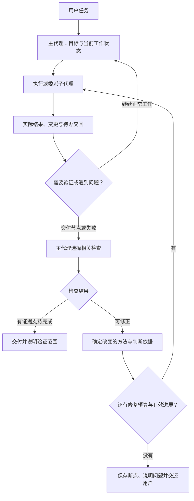

# ClearAct Lite 通用可靠性计划（已授权实施）

方案日期：2026-10-25。用户2026-10-27明确要求按计划修理并重试射击游戏。第一版已接入工作事实、技术性失败止损和交接；具体实现与测试边界见 [本轮说明](changes/2026-10-27-reliability.md)。下文保留原方案，不能将尚未完成的建议当成已实现。

最终已补齐成功检查的共享补救预算，71项回归与两个真实小任务通过。真实游戏续跑在无新证据后主动保存断点停止，游戏任务仍未通过，不能宣布复杂任务完成能力已解决；详情和后续待审查建议见[检查预算与实测](changes/2026-10-27-check-budget.md)。

## 目标与授权

游戏只是压力测试样本。目标是让Agent在不同任务中保留有效工作事实、完成主子代理交接、按需验证、自我修正，并在无法推进时及时保留断点和说明问题。

用户最新授权：允许合理的检查、主代理审查和自动补救；不允许无限重复无效工作。此前对重复检测和任务失败补救的一概禁止不再适用。检查和修复由任务需要触发，不在每个工具动作后增加一轮审查。

正常工作仍由同一个主代理决定工具与策略；不增加常驻审查代理、关键词意图分类、资料排序或搜索配额。协议校验、容量判断、执行回执和停止保护继续由程序承担。

## 建议的运行方式

图中检查合并到主代理正常决策轮次，不意味着每个节点都调用一次额外模型。小任务不强制制定复杂计划。

## 1. 先保留能继续工作的事实

复用现有事件、任务计划和工作断点，在统一契约中补充必要字段；原始消息及工具记录保持完整。

当前请求至少能够获得：用户目标、当前任务、已执行动作及结果、已确认接口和版本、失败操作、未完成事项、相关原文事件坐标。事实与模型推断分开标记。主代理、子代理交接和归档读取同一套结构，避免各自维护相互矛盾的摘要。

归档保留近期成功工具调用的有界参数、实际结果及引用，包括浏览器action/value等原来遗漏的参数。大段源码、图片和原始工具全文保留在历史或文件中，按需取回。容量预测仍区分服务实报、估算和未知值，累计usage不作为窗口占用。

此前正确接口名在归档后消失，属于已证实的信息损失；保留这些事实是否足以改善模型的错误恢复，仍须对照实验，不作保证。

## 2. 让主代理审查交付节点与失败

模型在需要拆分时说明交付物、依赖、共享接口、关联调用方和验证方法。子代理返回实际改动、接口变化、未完成事项及验证证据；未验证内容明确保留，不仅返回finished。

主代理在子任务交接、集成、交付前及实际失败时，决定是否进行与当前问题直接相关的检查。已有且仍有效的证据可以复用；相关文件或外部状态变化后，再判断哪些检查失效。

检查应回答一个明确问题，例如输出是否存在、数据是否一致、操作是否真的生效。语法通过、工具执行成功、模型正常结束、任务目标已验证分别记录。直接调用内部函数属于局部状态测试，不能据此声称真实交互或完整业务链路通过。

修复回合只需明确三件事：问题是什么、这次准备改变什么、什么结果能说明修复有效。它们进入记录和必要上下文，不要求每次普通工具调用都输出长篇解释。

## 3. 对无进展的失败设止损

以下是建议初始默认值，需经过测试和用户确认；不是已经接入的策略。

| 情况 | 建议处理 |
| --- | --- |
| 同一工具、实质相同参数、相同错误，相关输入版本与外部状态均未改变 | 连续2次后阻止第三次原样执行，转交主代理诊断；将错误、失败参数及最近成功事实一起提供 |
| 转入诊断后，模型仍选择同一个被阻止的无效动作 | 计入无进展补救次数，不能靠不断返回“已阻止”继续消耗模型 |
| 连续2个补救回合没有新信息、有效改动或检查改善 | 暂停当前执行、保存完整断点并说明原因；不重新启动一轮相同审查 |
| 修复产生了与问题相关的新证据或结果改善 | 可以继续；同一问题仍受可配置的时间/token预算约束，不能仅凭改问题名称或文件时间重置预算 |
| 分页位置前进、文件内容变化、日志增加、外部任务状态更新 | 属于可能有效的读取或等待，不按调用名称相同判为绕圈 |
| 网络暂时失败、异步任务等待 | 按错误性质和期限允许有限重试/轮询，避免每次结果暂未变化就误判停滞 |

程序第一版只对可证明的无变化失败作强约束，不宣称能自动理解所有语义上的绕圈。其他进展由主代理结合证据判断，并有整体预算兜底。实际进展判断需要在不同任务中验证，不能把任意文件改动或一句“已经修复”当作成功。

已经成功的外部动作不因补救而重放。写入或提交是否生效未知时，优先核对实际状态，再决定下一步。半截工具参数继续不执行；文件写入前快照，命令和远端服务副作用不宣称可以全部撤销。

“检查”和“诊断”也消耗同一问题的预算，防止把执行绕圈换成检查绕圈。默认不因为一次普通工具失败就向用户询问；经过有界修复仍无法推进时才交还。

## 4. 模块边界与兼容

| 位置 | 拟承担的调整 |
| --- | --- |
| core/contracts.py、必要的core/ports.py | 必要的工作状态、问题/补救状态及事件字段定义一次；增量字段有默认值，旧调用保持兼容 |
| context/builder.py、context/compaction.py | 保留必要事实、失败与当前修复状态，控制投影大小，保留原文引用 |
| runtime/runner.py、runtime/delegation.py | 将交接审查与修复交回主代理正常循环，沿用停止、超时和完整记录 |
| runtime/reliability.py（拟新增） | 有限的失败签名、状态变化、预算和止损逻辑；不实现任务领域策略或独立模型调用 |
| application / gateway / web | 从统一事件展示执行、验证、修复、需要用户处理；不各自定义一套状态 |
| development | 失败现场回放、误拦截测试、真实模型对照和用量；不进入Agent运行依赖 |

新增状态或接口时同步更新契约文档和消费者；原始消息、旧分支、快照和已有调用记录继续可读。拟新增模块不写入当前实际架构树，以免将计划冒充实现。

## 5. 分批实施与验收

**第一批：工作事实保留与失败回路止损。** 补归档和统一工作状态；加入最小的无变化失败识别、有界诊断机会及保存断点。使用已有失败上下文做原版/候选版对照，保存响应与用量，不把下一步选择正确当作整项任务通过。

**第二批：主子交接、按需验证与补救闭环。** 由主代理选择检查并处理失败，复用已有证据。补救状态与预算进入同一工作状态，归档后不失效、不清零。用文件编辑、数据整理、浏览器操作等不同任务验证，先不继续开发游戏。

**后续能力扩展独立评审。** 原生命令、持续键鼠和模型可见截图可以帮助验证，但不是第一批可靠性改造的前置条件，不一次性混入。

开发侧至少验证：

- 相同失败不会执行几十次；被拦截后也不会无限进行模型决策。
- 模型能改用有效方法，相关检查通过后继续正常任务。
- 合法分页、变化后的读取、合理轮询和暂时性失败不被一刀切拦截。
- 子代理的未完成事项能进入主代理修复；已执行副作用不会被重复提交。
- 归档、输出截断和用户停止后，事实、问题及补救预算一致；取消后能完整落盘。
- 多种真实任务的完成结果、误停止、无效动作数量、token和耗时分别记录；测试替身与真实模型分开。

不以检查数量或“没有报错”作为可靠性指标。不承诺模型永不出错；目标是提高实际完成率，并让无法完成时的停止、交接和证据可靠。

## 汇报方式

依据用户2026-10-25更新：聊天以建议、关键依据和需要决定的事项为主。完整模块变化、图、文件树、验证和失败保存在development文档及记录中，按需提供链接，不每轮展开全部细节。发现方向变化、重要失败或需要用户决定时及时说明。
