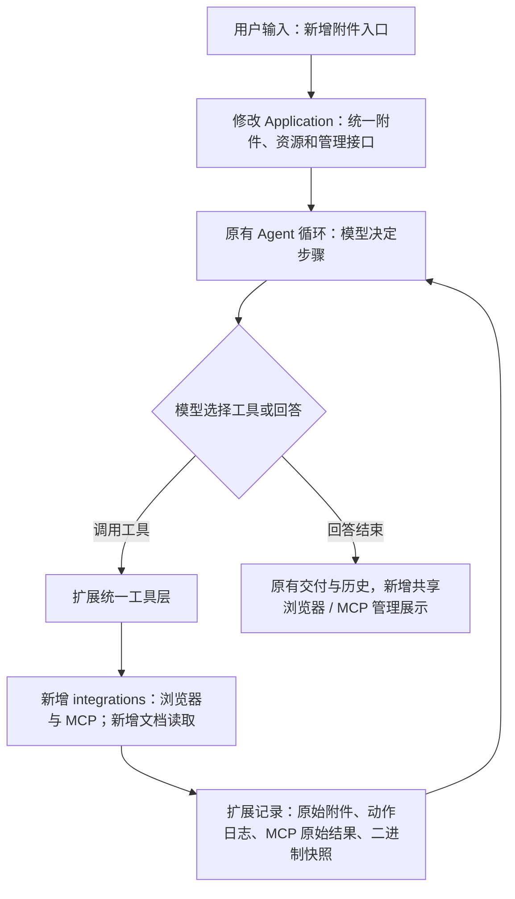

# 2026-10-22：MCP、共享浏览器和附件

本轮目标：把已有工作台接上可实际执行的外部工具和文件输入，保持模型选择任务策略，统一接口，完整记录。旧目录未修改、未清理、未提交或上传。

## 修改解释图

浏览器与 MCP 在 Agent 的工具循环内；UI 通过 Application 操作同一实例。没有增加独立任务审批或验收模型。完整树见 [本轮树快照](2026-10-22-capabilities-tree.txt)，持续维护的模块表与全流程见 [ARCHITECTURE.md](../ARCHITECTURE.md)。

## 修改的板块与理由

| 板块 | 改动及影响 |
| --- | --- |
| core / application | 新增资源 Port 和可选附件参数，旧消息/事件/结果仍为 v1；同工作区修改模型配置不丢工具会话 |
| integrations | 独立封装真实 Playwright 和 MCP SDK；懒启动、显式连接、超时与异步清理；上层不持有 SDK 类型 |
| tools | 从四项增加到十一项：目录、文档、浏览器三工具、MCP 两工具；Runner 不新增任务策略 |
| storage | 原始附件与工作副本分开；二进制写入沿用快照和恢复，不把图片解码成文本 diff |
| gateway / web | 上传/拖放/粘贴，实时共享浏览器及手动操作，MCP 配置/导入/连接；同一 HTTP v1 与 SSE |
| 安装 / CLI | 十项运行依赖、所有静态 JS 打包；使用同事件循环关闭 SDK 会话，启动器仍可双击使用 |
| development | 新增协议/浏览器/文档测试，真实原任务与能力验收，实际规则清单；失败现场原样保留 |

请求精简通过按需 MCP Schema、附件路径引用、分页读取和紧凑浏览器动作结果实现；没有额外总结/审查模型。尚无大任务 token 节省基线，不能声称在减少调用的同时已保证所有任务效果。

## 实际规则核对

没有额外审查模型、风险等级、关键词意图分类、资料排序、搜索配额、重复检测、自动验收催促、自动多轮补救或请求试错重发。仍保留参数/消息协议、工作区路径、超时、容量、写锁、冲突核对和本机网关保护。完整系统提示和实际值列于 [RULES.md](../RULES.md)，不能说完全没有规则。

## 验证与真实失败

| 检查 | 本轮结果 |
| --- | --- |
| 完整 pytest | 最终 39 项通过，7.07 秒，含真实 stdio / Streamable HTTP / SSE MCP、Edge、上传、PDF/DOCX/XLSX、二进制恢复及实际 MCP 执行中停止 |
| Ruff / Python 格式 / JS 语法 | 通过；45 份 Python 文件 |
| 新能力 UI | 六组通过；实际共享浏览器点击/输入、MCP 编辑与连接、四种附件、移动端布局；页面与控制台错误均为空 |
| 原工作台 Edge 回归 | 通过，覆盖历史、分支、停止、恢复和交付 |
| 实际 Windows 启动器 | 六组检查通过，默认双击打开网页、异目录启动、错误保留、就绪后打开浏览器、本地模型连接；测试进程已停止 |
| 真实本地模型首轮 | **独立验收失败**：附件内容正确，但模型把 12.5+7+2.5 算成 22.5，导致网页及报告总额 62.5；13 次调用，27.468 秒 |
| 一次明确反馈复测 | **纠正后通过**：同分支通过 MCP 逐项计算得到 22/62，真实重新提交并修正报告/截图；13 次调用，23.547 秒；不是从零一次成功 |
| 完整原始大游戏任务 | **未通过**：空目录运行 111.313 秒、2 次调用，在 8192 单次输出上限处停止；仅成功执行 file_list，未写入游戏文件，不能进行游戏路线验收 |

首轮真实模型输入/输出实报 **50804/1087**；明确反馈续轮为 **82257/878**；大任务 **4735/8217**。输入为多次请求累计，输出也是整轮累计；大任务单次上限 8192 与整轮 8217 不矛盾。这些不是独立上下文长度、缓存后计费量或节省比例。模型 `finished` 不当作独立通过。

初次新增集成测试为 37 通过、1 失败：本地 SSE 测试服务的全局退出事件绑定了上一个测试循环；修正测试夹具的生命周期后 38 项通过，没有把它当作生产客户端故障，也没有覆盖首次失败记录。

截图复核发现反馈复测的页面截图抓在首张预览解码前，浏览器区域出现占位。首轮截图保留；前端改为图片解码后显示，UI 验收增加 naturalWidth 检查，复测通过。这是展示时序问题，不影响已独立核对的网页提交和报告值。没有重新调用模型来替换原反馈记录。

## 证据索引

均相对于项目根目录，全部为本地忽略记录：

- `development/records/evals/capabilities-20261022-155635/before/`：改动前源码、安装配置和启动器备份；`before-sha256.json` 是原哈希。
- 同目录 `integration-01.log/xml`、`integration-02.log/xml`、`final-pytest.log/xml`、`review-pytest.log/xml`：首次失败、38 项通过及最终 39 项通过。
- 同目录 `local-context-measurement.json`：本地服务已加载上下文 100096；只更新了忽略的本机设置，通用默认值仍为 32768。
- `development/records/evals/capability-ui-20261022-162004/`：UI、实际 MCP 和共享浏览器截图。
- `development/records/evals/capability-ui-20261022-163317/`：图片解码时序修正后的最终 UI、共享浏览器截图与无脚本错误结果。
- `development/records/evals/capability-real-20261022-162050/`：首轮算错的报告、完整事件、提交结果、附件与截图。反馈复测共用其隔离工作目录，反馈前错误文件另存于下一目录 `before-report.json`，历史事件和快照保留。
- `development/records/evals/capability-feedback-20261022-162258/`：明确反馈原文、纠正前报告、纠正后完整事件、网页实际提交和截图。
- `development/records/evals/capability-large-20261022-162637/`：完整原任务、原始截断响应、失败报告和现场；没有可运行游戏，独立功能验收不可进行。
- `development/records/evals/web-ui-20261022-162924/`：原有网页交互回归。
- `development/records/evals/launcher-20261022-163200/`：实际启动脚本、本地模型连接和进程清理。
- 本轮主目录的 `final-verification.json`、`source-sha256.json`、`rules-audit.json`：最终静态/构建/启动验证索引、源码与规则审计哈希。

## 使用与未验证项

双击根 `clearact.cmd`，从输入框旁上传附件、左栏配置 MCP、顶部打开浏览器。MCP 不预置虚构服务，填写真实命令/地址后连接。Windows 默认使用 Edge，无浏览器环境需安装 Chromium。

未接交互 OAuth、OCR、旧 .doc/.xls、多模态图片输入、独立命令执行或专用 Office 写入；未验证所有第三方 MCP 服务。网页/MCP 外部副作用无法用文件快照撤销，外部服务不是工作区沙箱。复杂长任务仍会受模型算术、输出截断和能力影响，本轮没有宣称全面解决。

源文件逐项职责见本轮树快照，测试现场与 Agent 代码分开保存。没有复制旧运行框架，没有把旧 613 项测试或旧游戏验收计入本轮。
