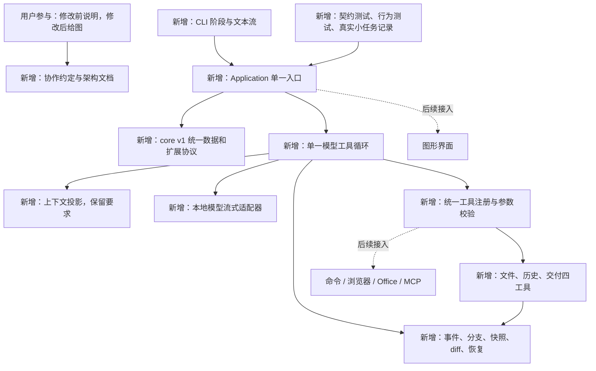

# 2026-10-22：建立架构基础版

位置更新：本轮资料已统一搬到 `development/`。下文 `data/evals/` 为当时记录位置，当前对应 `development/records/evals/`；原始日志不改写。首轮文件树保存于 `2026-10-22-foundation-tree.txt`。

## 本轮目的和修改解释图

从空目录建立独立、可运行、可审阅的架构。下图所有实线板块为本轮新增，虚线扩展尚未实现。

## 为什么这样拆

用户的四个核心要求落实为：本地接入和精简请求在 settings/providers/context；透明回溯在 storage/events；模块化通过 ports 和单一装配点；统一接口通过 core v1 和 Application。只有一个执行循环，没有额外的策略调度体系。

每个工具必须返回同一种 ToolResult，模型必须返回同一种 ModelReply。供应商协议差异在适配器转换，界面通过同一 Application 工作。新增工具无需改执行循环。

分支保留历史但不自动切换工作文件。恢复文件是显式操作，核对当前哈希后才执行；没有宣称任意命令或远端副作用都能撤销。

## 验证与失败现场

最终验证：

| 检查 | 实际结果 |
| --- | --- |
| 自动化行为与契约测试 | 23 项通过，0.55 秒；使用测试替身，不算真实模型 |
| Ruff 静态与格式检查 | 通过，27 个 Python 文件格式检查通过 |
| CLI 启动入口 | `clearact.cmd --help` 通过 |
| 最终真实本地 Qwen 文件小任务 | 通过；创建、读取核对、登记交付及独立字节比较 |
| 最终小任务用量/耗时 | 4 次模型调用；累计输入/输出 3108/121 token；4.125 秒 |
| 复杂长任务、图形界面、浏览器等完整验收 | 尚未进行；本轮不宣称通过 |

最终自动化结果：`data/evals/foundation-tests-04.xml`。最终真实模型原始结果及逐调用用量：`data/evals/foundation-20261022-145607/evaluation.json`，对应隔离目录内保留文件、SQLite 记录和快照。

以下初始失败保留，不计入功能通过：

- 首次静态检查发现前向类型引用和格式问题，已修正。
- 首次 pytest 未创建 basetemp 的父目录，19 项均在 setup 阶段失败，未运行测试本体。后续先创建父目录，使用新的隔离路径重跑；不是应用故障。
- 未带鉴权的本地服务探测返回 HTTP 401，未发生模型生成。随后在单独测试进程只读读取旧项目对应本地配置，密钥没有打印或写入新项目。

第一次真实小任务：本地 qwen/qwen3.8-27b，思考 none、输出上限 8192、温度 0.1；4 次调用，5.375 秒，服务上报累计输入/输出 3108/156 token。文件内容独立字节比较一致。原始结果在 `data/evals/foundation-20261022-144927/evaluation.json`。后续最终复验另存新目录，不替换该现场。

## 当前限制

- 尚无图形界面；阶段和修改证据已有真实事件，CLI 提供基础阶段和流式输出，完整 diff 在 history/report 中。
- 命令、浏览器、Office、MCP 尚未接入，不能完成依赖这些工具的大任务。
- 当前没有历史摘要、长上下文自动恢复或崩溃自动续跑。达到上下文上限会停止，未闭合事务不会被重放。
- 文件工具当前限所选工作目录，文件快照只恢复字节。短暂同步文件操作不支持在操作中间取消。
- 只有小任务真实验收；尚无复杂长任务独立验收，也没有 token 优化比例或效果不下降的基线证据。
- 适配器当前支持本地流式兼容接口，不承诺所有厂商字段通用；不自动更改参数重发请求。

完整逐文件职责、流程和模块表见 `../ARCHITECTURE.md`；公共接口见 `../CONTRACTS.md`。
