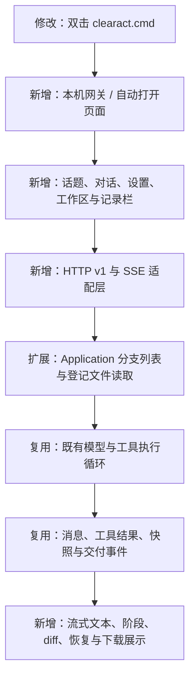

# 2026-10-22：接入本地网页工作台

## 本轮范围

用户要求依照旧版 Agent 的界面模式补上前端。只读参考旧版 HTML、CSS 与网关边界，沿用“左侧历史话题、中央对话与输入框、设置弹窗”的浅色玻璃风格；新版增加可收起的执行记录栏和手机适配。

本轮新增页面和 HTTP 适配层。模型决策、工具执行、上下文投影、停止和快照仍使用既有模块，没有复制旧执行框架或增加任务策略。

## 修改解释图



任务主流程仍只有一个入口；实时展示从同一套真实事件读取，不增加模型调用。

| 板块 | 新增或修改 |
| --- | --- |
| 启动 | 无参数进入网页并在 HTTP 就绪后打开浏览器，优先使用 .venv，错误后保留窗口 |
| gateway | 输入校验、活动任务、脱敏配置、SSE、API 和本机服务 |
| web | 话题、续聊、设置、工作区、流式文本、阶段、工具详情、diff、恢复、分支、下载、深色主题、手机布局 |
| Application/core/storage | 增加 BranchInfo 和派生分支列表；增加带登记哈希核对的文件读取；数据库结构及既有字段未变 |
| 包配置 | 新增 FastAPI/uvicorn；静态文件随包分发；页面无 Node 构建、CDN 或额外前端依赖 |
| 开发资料 | HTTP 测试、Edge 和启动验收脚本、现场、截图、用量及本轮文件树仍统一在 development/ |

## 文件树

本轮完整逐文件树固定保存在 `2026-10-22-frontend-tree.txt`。主要变更如下：

```text
clearact-lite/
├── clearact.cmd                        修改：双击启动和错误窗口保留
├── pyproject.toml                      修改：网关依赖、静态资源和可选验收依赖
├── README.md                           修改：网页运行与配置说明
├── src/clearact_lite/
│   ├── cli.py                          修改：默认网页入口和 web 命令
│   ├── application.py                  扩展：分支列表与交付读取
│   ├── core/contracts.py               扩展：BranchInfo
│   ├── core/ports.py                   扩展：分支列表端口
│   ├── storage/sqlite.py               扩展：由历史派生话题列表
│   ├── gateway/                        新增：独立 HTTP 适配器
│   │   ├── __init__.py                  模块边界
│   │   ├── contracts.py                 HTTP v1 输入校验
│   │   ├── service.py                   设置、活动任务、事件与连接检查
│   │   └── server.py                    路由、SSE、静态文件与本机启动
│   └── web/                            新增：旧版风格的轻量页面
│       ├── index.html                   页面和弹窗结构
│       ├── style.css                    响应式、浅色和深色样式
│       └── app.js                       状态、交互、流式展示与文件操作
└── development/
    ├── tests/test_gateway.py            新增：HTTP 与应用集成测试
    ├── tests/test_contract_boundary.py  更新：约束 core 不依赖网关或网页
    ├── scripts/verify_frontend.py        新增：Edge 替身/真实模型验收
    ├── scripts/verify_launcher.py        新增：真实 Windows 启动器验证
    ├── docs/                           更新：架构、接口、本轮图和树快照
    └── records/evals/                   测试、失败、截图和用量，原样保留
```

## 验证和失败现场

本轮验证使用的模型为本机 qwen/qwen3.8-27b，接口 localhost:1235/v1，思考 none、输出上限 8192、温度 0.1。没有使用付费云模型。

| 验证 | 结果与证据 |
| --- | --- |
| 自动化测试 | 已有及新增 HTTP 测试 29 项通过；最终 0.91 秒，无警告；首次结果在 frontend-20261022-152952/ |
| Edge 交互替身测试 | 8 组通过：设置、执行与下载、续聊/diff/恢复、分支与刷新、停止、主题、桌面与手机、工作区切换；不是模型效果验收 |
| 真实多文件任务 | 四个输入、三个输出，汇总数值独立检查一致，输入保持不变，交付登记齐全；5 次调用，14.078 秒，输入/输出 8172/907 token |
| 真实续聊 | report.md 追加修改并重新交付；4 次调用，5 秒，输入/输出 10711/170 token |
| 生成网页独立检查 | Edge 打开生成的 dashboard.html，表格与汇总数值通过 |
| 页面脚本异常 | 上述交互和真实模型页均未检测到 pageerror |
| 实际 Windows 启动 | 无参数启动、其他当前目录启动、HTTP 就绪后触发浏览器打开、错误保留和本地模型连接检查通过；launcher-20261022-153733/ |

真实模型完整事件、原始逐调用响应和上报用量保存在 `development/records/evals/web-ui-20261022-153258/`。输入 token 为多轮请求累计，不是单个上下文长度或未缓存计费量。没有上报的用量继续为 null。

保留的失败：

- `web-ui-20261022-153222/`：验收脚本使用异步页面谓词等待结束，提前进入下一条断言；模型当时仍在处理。检查退出时停止了该任务，记录为 stopped，不算通过。修正为逐次等待实际接口状态，后续使用新目录重测。
- `launcher-20261022-153517/`：测试服务启动并触发浏览器打开，但验收脚本结束子进程树的方式未完成，最终等待超时。已核对并结束该次自建进程，修正测试清理方法后另存通过结果；不是应用启动失败。
- 开发过程中静态检查发现的格式问题修正后再进行最终检查，不将早期检查说成全部通过。

## 本机使用与限制

双击项目根 `clearact.cmd`，默认打开 `http://127.0.0.1:8875`。保留服务窗口，按 Ctrl+C 结束。端口占用可使用 `clearact.cmd web --port 8876 --open`。

已初始化必要的本地 Qwen 连接信息，密钥仅保存在项目 `.clearact/web-settings.json`，Git 忽略且页面不回显；未迁移旧任务和附件。页面支持一个当前模型配置，可在设置中替换，不是旧版全部模型配置的批量导入。

浏览器、Office、命令、MCP、附件上传和旧版全部个性化效果尚未接入，页面不显示伪装为可用的工具入口。本轮是网页工作台和多文件链路验收，不等同于旧版复杂游戏任务的独立全流程验收；该验收仍未完成。分支仅保存对话历史，工作文件仍共享当前内容。

最终复验索引在本轮完成后补充于下方；历史现场不会被后一次结果覆盖。

最终复验：

- `development/records/evals/frontend-final-20261022-154127/`：29 项回归、Ruff、34 个 Python 文件格式检查、JS 语法检查、页面交互复验、启动器复验的原始日志与源码哈希。
- `development/records/evals/web-ui-20261022-154129/`：最终 Edge 交互结果及桌面、修改预览、深色、手机截图，8 组通过，pageerror 为空。
- `development/records/evals/launcher-20261022-154133/`：最终 Windows 启动检查通过，测试创建的进程树已结束。
- `development/records/evals/web-ui-20261022-153258/independent-acceptance.json`：独立复核类别汇总、续聊后四个输入字节不变、两个其他输出不变、报告只追加指定内容、HTML 表格各单元格正确。
- 隔离副本中的 wheel 构建通过，实际包内含 index.html、style.css、app.js；构建副本、wheel 和日志位于最终复验目录，没有在 Agent 源码目录留下构建痕迹。

本轮结束时未保留验收启动的网关服务；用户双击脚本后启动自己的工作台。
