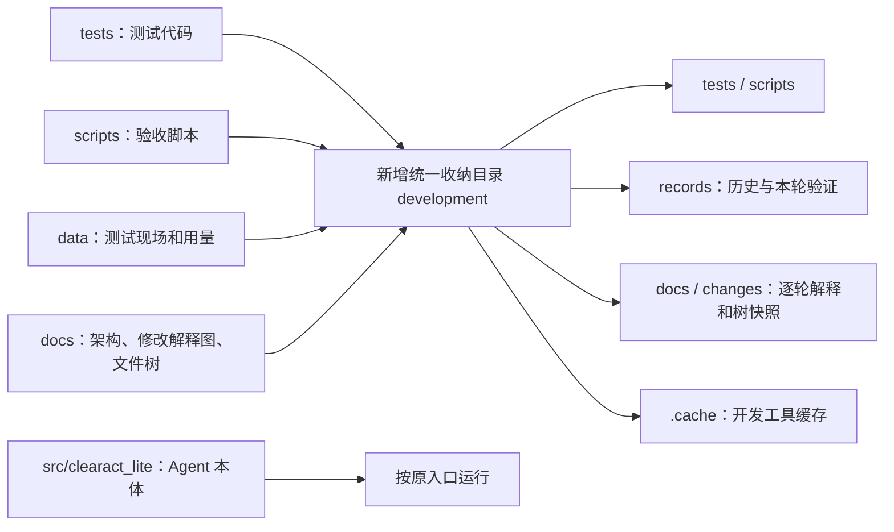

# 2026-10-22：区分 Agent 本体与开发验收资料

## 修改解释图



## 本轮文件树

```text
clearact-lite/
├── src/clearact_lite/                Agent 本体，源码保持原样
├── clearact.cmd                      原启动入口
├── pyproject.toml                    修改测试发现和缓存路径
├── README.md                         修改导航、验证命令与工作目录示例
├── AGENTS.md                         固定开发资料统一收纳规则
├── .gitignore                        排除原始记录、开发缓存和用户工作目录
└── development/
    ├── README.md                     新增统一导航
    ├── tests/                        从根 tests/ 搬入，修正源码定位
    ├── scripts/                      从根 scripts/ 搬入，修正现场输出路径
    ├── docs/
    │   ├── ARCHITECTURE.md            更新后的完整逐文件树与总流程
    │   ├── CONTRACTS.md               统一接口说明
    │   ├── WORKFLOW.md                更新逐轮图与树的保存规则
    │   └── changes/
    │       ├── 2026-10-22-foundation.md        首轮修改解释与验证
    │       ├── 2026-10-22-foundation-tree.txt  保留首轮原始文件树
    │       ├── 2026-10-22-layout.md            本轮解释图和文件树
    │       └── 2026-10-22-layout-tree.txt      本轮完整文件树快照
    ├── records/
    │   ├── layout-relocation-inventory.json   搬迁清单和原始内容哈希
    │   └── evals/                    原始测试现场及各轮新验证
    └── .cache/                       开发工具缓存
```

本轮完整逐文件树另存为 `2026-10-22-layout-tree.txt`，以后更新当前架构时不覆盖该快照。

Agent 的执行逻辑、工具和公共接口没有变化。修改仅涉及资料布局、开发配置、脚本和文档引用；包仍只包含 `src` 下的 Agent 代码。

## 验证

目录搬迁时已核对 131 个文件的 SHA256，搬迁没有改变内容。随后只更新活跃文档、测试定位和验收脚本；原始运行证据继续保持原始内容。

最终验证目录：`development/records/evals/layout-20261022-150403-352463/`，含 `pytest.xml`、四份检查原始日志和 `verification.json`。

- 自动化测试：23 项通过，0.55 秒，无警告。
- Ruff 静态检查和格式检查通过，CLI 启动检查通过。
- 复核迁移的 116 个原始测试证据文件，内容哈希一致；24 个 Agent 源文件与首轮验收哈希一致。
- 未重跑真实模型任务：Agent 执行代码未修改。

前一次结构复验保留在 `development/records/evals/layout-20261022-150344-260515/`。当时 23 项通过但有一条 pytest 配置警告：禁用缓存插件的旧命令与新增缓存目录配置冲突。已更新验证命令，最终复验无警告；旧日志保留。
