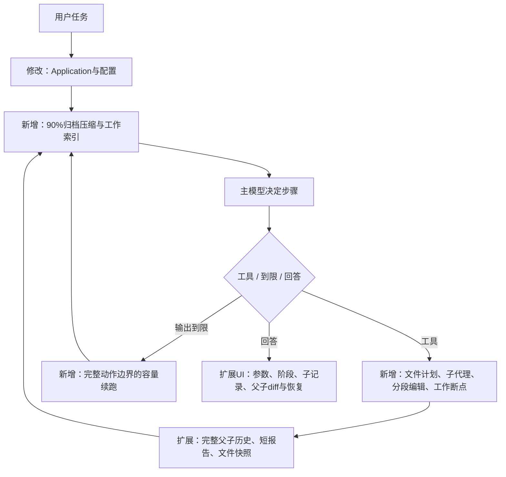

# 2026-10-22：上下文、文件计划、子代理与容量断点

用户明确要求90%自动压缩、先制定文件职责计划、子代理独立写文件、长文件分段、到限后从断点继续，并要求专门测试及比较参数。旧目录只读参考，没有提交或上传。

## 修改解释图

完整文件树及逐文件职责见 [本轮树](2026-10-22-long-work-tree.txt)，当前模块表与全流程见 [ARCHITECTURE.md](../ARCHITECTURE.md)，新规则见 [RULES.md](../RULES.md)。主模型和子代理共用Runner与工具契约，不另造执行框架。

## 设计决定与限制

- 压缩为完整事务归档＋工作索引，不额外调用总结模型。原始用户要求、system、历史与旧分支保留；早期语义细节可能需要从原文回查，不能称为语义无损。
- 90%按保守输入估算和输出预留计算；累计usage不算占用。比例可配置，目标默认60%；固定内容仍过长时明确停止。
- 文件计划由模型通过task_plan产生，列每个文件职责、公共接口与依赖。子代理单层串行，仅写分配文件；主代理只收短报告/哈希/坐标，完整子消息独立保存。总token未必下降。
- 首轮完整游戏中，文件子代理执行了大量整体验收且重复内嵌其他任务的美术，15分钟超时。默认子工具已收窄为文件类，其他工具由模型在计划里指定，并传入完整文件职责表。这是分工与能力配置，不是新增审查、验收催促或重复行为检测。
- file_edit追加核对字节位置，替换核对唯一原文；每次完整写入保存快照。截断JSON不执行，续跑从完整落盘点发起新请求，不默认卸载重载模型。
- 普通服务/工具/验收失败不触发自动补救；容量续跑受整轮超时和停止控制。持续输出过长仍可能耗尽时间。
- 父子调用数和实报用量合计，未知保持null。子修改可以在页面预览和原分支恢复；外部副作用不能靠文件快照全部撤销。

## 参数组合比较

真实本地Qwen，RTX3090 24GB；只读硬件采样不等于峰值显存测量。相同计数工作台目标、原始历史夹具、文件计划/子代理、浏览器检查和独立电脑/手机验收。每套目前单轮；8192那套分段目标不同，属于配置组合比较，不能把差异全归因于输出上限。预填充缓存、生成内容和检查次数也会影响耗时，不代表统计或全局最优。

| 记录 | 输出上限 / 压缩阈值 / 建议分段token | 独立通过 | 秒 | 主子总调用 | 实报输入/输出 |
| --- | --- | --- | --- | --- | --- |
| long-matrix-20261022-194908 | 8192 / 0.9 / 1024 | False | 32.063 | 2 | None/None |
| long-matrix-20261022-194908 | 16384 / 0.9 / 2048 | False | 0.422 | 1 | None/None |
| long-matrix-20261022-194908 | 32768 / 0.9 / 2048 | False | 0.391 | 1 | None/None |
| long-matrix-20261022-194908 | 16384 / 0.8 / 2048 | False | 0.406 | 1 | None/None |
| long-matrix-20261022-195024 | 8192 / 0.9 / 1024 | True | 205.641 | 43 | 431467/6301 |
| long-matrix-20261022-195024 | 16384 / 0.9 / 2048 | True | 170.594 | 44 | 393414/5534 |
| long-matrix-20261022-195024 | 32768 / 0.9 / 2048 | True | 201.906 | 55 | 475436/6443 |
| long-matrix-20261022-195024 | 16384 / 0.8 / 2048 | False | 300.031 | 177 | None/None |

## 已发现并保留的失败

1. 首次旧截断测试仍期待停止，新默认已变为续跑；保留其失败，旧行为测试显式关闭auto_continue，并另测新续跑。
2. 新测试曾误把序列化dict当Event；修正测试消费者，失败原记录保留。
3. 本地HTTP MCP服务退出出现一次等待超时；测试夹具设置有界优雅关闭，后续完整回归通过，原日志保留。
4. 首轮四组真实比较均被Qwen模板拒绝：压缩索引和原system形成两条system。请求投影已合并首部system，原记录不改，补测单一system后另开目录重新比较。
5. UI脚本曾将中文UTF-8字节数写错、并在恢复请求结束前断言；修正夹具字节计算及等待响应，旧失败截图保留，后续UI通过。不是删掉校验来通过。

## 验证与证据

主记录目录 `development/records/evals/long-work-20261022-193610/` 包含before源码/哈希、各次pytest失败/通过、硬件采样和最终manifest。完整回归、静态检查及最终汇总以同目录final-verification.json为准，不能用旧版613项或上轮成绩替代。

以下为本轮实际现场（原记录保留）：
- `development/records/evals/long-boundary-20261022-200549/capacity/boundary.json`
- `development/records/evals/long-boundary-20261022-200549/capacity/overflow-detail.json`
- `development/records/evals/long-large-20261022-200835/original-game/evaluation.json`
- `development/records/evals/long-large-20261022-202743/original-game/evaluation.json`
- `development/records/evals/long-large-20261022-200835/original-game/independent-20261022-202429/independent.json`
- `development/records/evals/long-large-20261022-202743/original-game/independent-20261022-204252/independent.json`
- `development/records/evals/long-ui-20261022-195504/verification.json`
- `development/records/evals/long-ui-20261022-195533/verification.json`
- `development/records/evals/long-ui-20261022-195606/verification.json`
- `development/records/evals/long-ui-20261022-203937/verification.json`

## 最终结论与参数应用

本轮完整回归47项通过，8.03秒。显式禁用pytest缓存插件时出现cache_dir配置警告，无失败。Ruff检查、52份Python格式检查、JavaScript语法检查通过。真实Edge长任务界面交互通过；该界面测试使用协议替身。隔离wheel包含长任务模块和全部4份网页资源，不包含私有配置或开发现场。打包检查脚本最初错写了不存在的browser.html，正确资源为capabilities.js；保留原检查失败，修正检查清单后对同一wheel复查通过，没有借此修改产品。

真实边界测试8次请求累计输入128288 token，每次16036，均成功。单次110023 token超出实际100096窗口，服务明确返回400 exceed_context_size_error；不卸载模型，紧接着16输入/2输出的小请求正常返回OK。累计用量不是模型一直被占满的上下文。并发探针仅为独立推理请求，受缓存影响，不足以证明完整子代理并行有稳定收益，当前保持串行。

暂定本机组合：容量100096、单次输出16384、压缩90%→60%、温度0.1、思考none、串行子代理；分段2048仅为实验中的指导值，不是新增硬性次数或输出配额。16k组合在小任务单轮比较中较快、实报token较少，比较发生在默认子工具收窄之前，且有缓存和生成行为混杂，不能称为全局最优。请求超时调到360秒，依据是真实出现188秒响应；整轮超时保留用户原600秒，没有以无限延长来隐藏失败。配置中仅更新parameters.json列出的公开字段，私钥保持原值，不输出。

首轮完整游戏900秒未完成：子代理把美术重复内嵌到引擎并执行大量整体验收，后续任务未完成。独立实际路线虽4/4走通，但只有1个选择点且没有实际音频实现，整体失败；不能将文件存在或部分路线通过说成完成。该轮自然16384输出截断及写入后人为诱发1 token截断均被记录，半截调用未执行，后续从完整文件点继续，仍不代表整个游戏成功。

第二轮在默认文件类子工具与完整文件职责表变更后单独运行，900.031秒超时，71次调用；引擎、页面、样式和美术已有文件，但story.js尚未生成，剧情任务未开始，整体未完成。独立Edge打开副本后未取到剧情，最初适配器通用错误写成结构不支持；进一步只读核对发现页面引用的story.js缺失，诊断另存incomplete-diagnosis.json，原错误保留，没有重复运行或修改游戏。原始用量含中断未知项，总量保持null。不再自动追加修复轮次。完整大任务结论以final-verification.json中各轮generation状态和独立验收共同判定；本轮复杂任务尚未解决。原evaluation.json的pending字段保留原始值，由独立报告和最终汇总关联，不改写旧记录。

最终状态汇总、每轮失败、独立检查路径和本轮源码哈希见主记录目录final-verification.json；公开配置前后值与限制见parameters.json；实际规则审计见rules-audit.json。没有加入额外审查模型、验收催促、重复行为检测、普通失败自动重试或搜索配额。

## 完整游戏各轮实测

- `development\records\evals\long-large-20261022-200835\original-game\evaluation.json`：failed，900.031秒，141次调用；完整通过=False；用量={'input_tokens': None, 'output_tokens': None}。
  - 独立验收 `development\records\evals\long-large-20261022-200835\original-game\independent-20261022-202429\independent.json`：通过=False，检查={'all_reachable_routes': True, 'at_least_three_choice_points': False, 'at_least_two_endings': True, 'three_backgrounds': True, 'three_characters_with_two_expressions': True, 'audio_implementation_present': False}，错误=None。
- `development\records\evals\long-large-20261022-202743\original-game\evaluation.json`：failed，900.031秒，71次调用；完整通过=False；用量={'input_tokens': None, 'output_tokens': None}。
  - 独立验收 `development\records\evals\long-large-20261022-202743\original-game\independent-20261022-204252\independent.json`：通过=False，检查=None，错误=ValueError: Unsupported generated story structure; adapter required。
