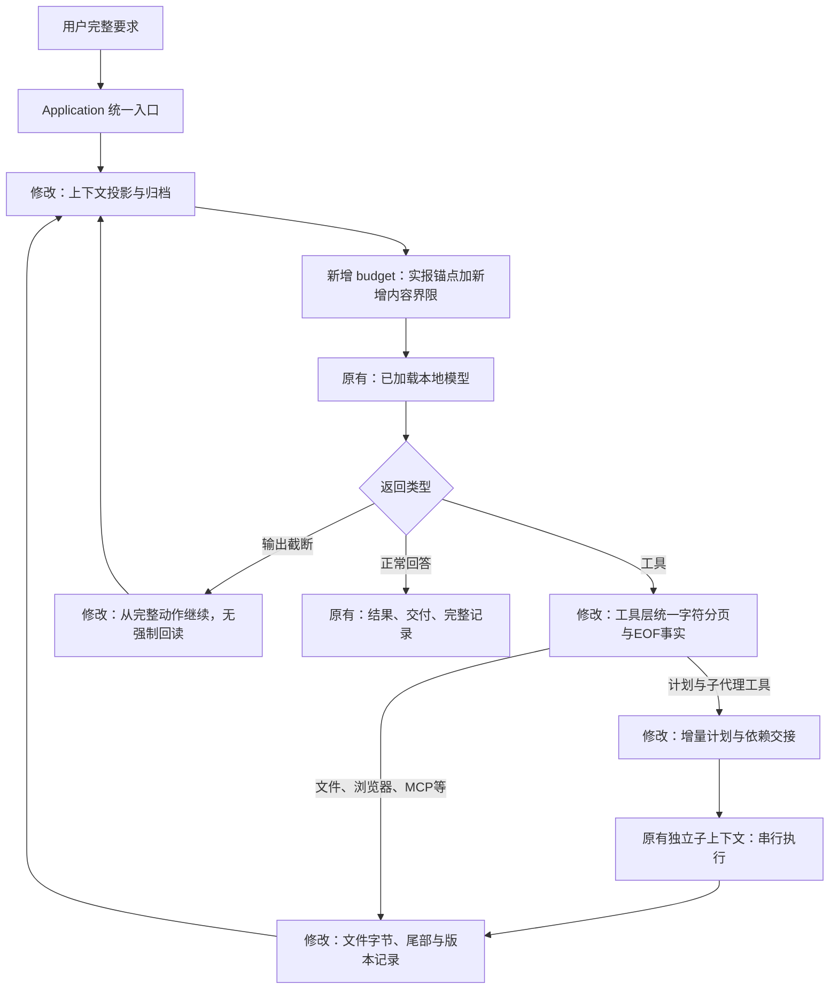

# 2026-10-23：任务分配、归档与容量修复

用户授权修复此前游戏长任务未完成的原因，要求测试后展示结构。本轮只改这些相关模块；未增加审查模型、意图分类、配额、重复拦截、自动验收催促或失败补救轮次。未提交或上传。

## 修改解释图

本轮完整逐文件职责在[文件树](2026-10-23-context-repair-tree.txt)，持续更新的流程、模块总表和完整结构在[ARCHITECTURE](../ARCHITECTURE.md)。开发资料与 Agent 本体仍完全分开。

## 原因、改动与影响

| 板块 | 原问题 | 本轮改动与影响 |
| --- | --- | --- |
| 容量预算 | UTF-8字节界限在大量源码时明显高估；首次归档时服务输入32765，加16384输出仅49.10%，旧估算却96.13% | 新增 budget，匹配同模型/工具/消息前缀的实报输入，保守计算新增内容；估算和实报分开。离线重放新估算34301，含预留50.64%，不提前归档 |
| 归档 | 为达到60%目标把所有最近写入一起归档；读取源码又被摘录 | 保留最近写入所属完整事务及当前完整事务，60%为软目标；不删除用户要求和原始记录，不保证语义摘要无损 |
| 工作状态 | 模型断点过时，旧工作索引泛化要求先读文件 | 写入与恢复记录字节位置、哈希、最后文件尾部；标出断点后的文件事件，保留调用意图与坐标；移除一律回读要求 |
| 任务分配 | 一个子代理承担整款游戏，先做素材、引擎迟迟未完成 | 提示和工具说明改为可运行核心、有限增量和交付物；依赖交接带实际文件和短报告。工具仍由模型选择，未做强制文件数或计划语义审查 |
| 公共接口 | 新字段容易散落、改变旧消费者 | RequestFootprint/可选deliverable在core统一定义，旧计划仍可读；Application、Provider、HTTP v1未变。契约详见[CONTRACTS](../CONTRACTS.md) |
| 字符分页 | 本地模型读取超过文件末尾后仍继续增加偏移；结果没有显式EOF或下一段游标 | core新增TextRange，文件/历史共用next_offset/eof；旧参数与结果开头保留。不自动翻页、不拦截重复、不增加模型检查 |
| 目录工具 | 绝对工作区根目录被拒绝 | file_list接受绝对根和点号；原路径与记录保护不变 |

没有匹配的服务实报时仍退回字节保守界限，因此不是精确 tokenizer。变更模型、工具定义或消息前缀会失效旧锚点。必要工作内容本身超出窗口时仍停止，不靠丢用户要求腾空间。子代理仍单层串行，可能增加总token。

## 验证与现场

- 最终自动回归：58项通过，8.41秒；Ruff检查及格式检查通过。包括非ASCII字符坐标、末尾与越界、恢复可见性、工作集保留及依赖交接。首次失败和调整过的旧假设测试保留。禁用pytest缓存插件后出现cache_dir配置警告，不影响断言。
- 旧失败重放：使用原276次子请求和原实报用量，不发新模型请求、不改旧现场；新预算不再于约49%实际占用时归档。记录：`development/records/evals/repair-replay-20261023-173015/replay.json`。
- Edge工作台：`long-ui-20261023-185132/verification.json`最终源码通过；模型为协议替身，覆盖设置、归档、容量续跑、子记录及文件恢复。早两次失败及较早通过轮次的Windows连接/关闭超时日志保留；最终轮次无这些清理警告，不当成真实模型任务通过。
- 完整真实游戏首轮：`E:\game\repair-20261023-173506`，1800.062秒到时失败，470次调用。1次归档、1次真实输出截断续跑，已实报小计输入16966837/输出95953；最后第470次未知，完整累计为null。66545字节文件无法开始，未通过独立验收。运行期间源码未变。
- 提示复测：`E:\game\repair-final-20261023-180007`确实分成core/art/story/polish。core完成后主代理打开浏览器并委派art，但art越界回读，开发人员手动中断测试进程。333次尝试，332次完整指标，剩余用量未知；不伪造RunResult或正常停止记录。原SQLite只读导出，保留全部历史。独立Edge桌面2条、手机2条占位核心路线交互通过，但美术、完整剧情、两个不同结局和长度均未达标，整款游戏未通过。
- 分页修复完整复测：`E:\game\repair-cursor-20261023-182500`从空目录执行同一原始任务，正常结束，1448.828秒、171次调用；独立电脑18条、手机18条可达路线均通过下述功能断言。所有轮次没有缩小目标、没有手工修游戏，原E盘失败文件保留。
- 真实测试参数：本地Qwen、100096上下文、16384输出、none思考、温度0.1、90%/60%。测试期间只将整轮超时覆盖为1800秒，原保存配置仍为600秒；测试结束取得1448.828秒完成证据后，仅将本机保存的整轮超时改为1800秒。其他配置未改，字段级前后记录单独保留。不卸载或重载模型，无云端付费调用。

本轮原始现场：`development/records/evals/context-repair-20261023-171801/`，包括修复前源码、哈希、所有回归与UI失败、真实父子消息、模型响应、快照、用量、速度与负载。旧失败诊断保持原字节。

### 首轮真实游戏暴露的问题与同轮收敛

首轮计划仍把全部实现放在一个core子代理，再列一个test任务。子代理699.844秒写出了66545字节，但初始HTML已经关闭script/body/html，后续美术、剧情、引擎却用EOF追加到标签外。独立Edge电脑点击、手机触摸均无法开始；`STORY/goto`未定义，也没有页面异常（这些脚本根本没有执行）。不能把“引擎正文已经写出”当作可运行。

模型测试任务随后连续查询标题CSS状态，运行时未加重复检测或验收补救。真实容量归档事件的触发估算73931，加16384预留约90.23%；归档后估算43193，并继续请求，未卸载模型。说明容量机制可以工作，不说明任务已完成。

针对这一失败，候选提示明确“全部实现＋测试不算实现拆分”，给出独立引擎、剧情和素材文件的示例，并说明EOF追加不会插入已关闭标签。一次本地真实规划样本分出core/art/story/test，并给test声明浏览器工具；实报3500输入/1957输出。该样本只制定计划，没有执行工具，不能算整款游戏通过。

规划样本与首轮压力测试在2026-10-23 09:55:46—09:56:53 UTC重叠，相关速度不能按独占模型环境解释；系统负载本来也是全机采样。原始响应和用量均保留。

回溯测试另发现恢复文件后索引可能仍为旧版本；增加了未归档/已归档两种恢复可见性用例，修复前两项失败现场单独保存。

首轮长输出（≥256 token且流阶段≥1秒）11个样本，加权近似71.149 token/秒，中位70.769；不是GPU纯解码速度，也不是整轮有效产出速度。单次服务实报输入最大71535。已归档后的下一请求实报8856输入，与归档前后估算值分别保存。`real-game/performance-summary.json`及图保留全部统计和局限；并发规划样本造成的影响已单列，不能作严格速度因果对照。

分页改动后，一次真实下一步样本将新EOF结果放回已陷入越界读取的上下文，模型仍请求更大偏移（文件8043字符，先前14200、下一次14300）。实报69481输入/42输出。该样本未执行返回工具，不能宣称EOF字段已经解决模型循环；从空目录复测的结果另列。开发脚本的手动停止标记仅由开发人员写入，通过Application.stop取消，不在Agent内自动判断任务失败或重复。

## 尚未证明的能力

本次是当前机器和本地Qwen的一次最终完整功能通过，不能保证所有复杂任务稳定完成，也未找到全局最优参数。分页EOF样本仍曾继续越界读取，因此不宣称模型循环已被根治。最终游戏未触发归档/输出截断；容量机制的实际触发证据来自首轮失败游戏，另有离线重放和自动边界测试。未做最终游戏填满100k窗口后的成功对照试验。恢复索引验证限于发生恢复的同一分支，跨子分支恢复对父上下文的同步尚未验证。正文时长仅按长度估算，未人工计时；素材数量、引用与实际SVG渲染已检查，美术精细程度和音频主观听感不作自动通过承诺。自动测试、历史613项和旧游戏成绩不能替代本次真实任务验收。

## 最终完整游戏结果

同一份原始中文视觉小说任务，从隔离空目录开始；没有手工修改生成游戏，也没有把独立验收失败反馈给Agent续跑。最终运行与当前44份运行文件哈希一致。此次只完成未结束的浏览器验收，未因模型重新上线重复发起生成请求。

模型本次实际任务划分如下；这是模型生成的计划，运行时没有硬编码五个阶段：

| 子任务 | 分配文件 | 依赖与职责 |
| --- | --- | --- |
| core | index.html、engine.js、story.js | 先创建可运行核心与占位剧情 |
| art-bg | art.js、engine.js | 依赖core，补充背景并接入引擎 |
| art-char | art.js、engine.js、story.js | 依赖art-bg，补充角色与表情 |
| story-full | story.js | 依赖art-char，写完整剧情分支 |
| polish | engine.js、index.html、story.js | 依赖story-full，整合与游玩检查 |

| 项目 | 结果 |
| --- | --- |
| Agent运行 | finished；1448.828秒；171次调用；五个串行独立子代理 |
| 文件交付 | index.html / engine.js / story.js / art.js，四项均登记并核对哈希 |
| 真实用量 | 累计输入3,771,175 / 输出89,216 token，171次均有实报；累计输入不是单次上下文长度或未缓存计费量 |
| 独立真实Edge | 电脑1280px的18条 + 手机390px触摸18条，共36/36；每条完整进入结局 |
| 内容与交互 | 117节点、3选择点、2不同结局；逐路线正文、刷新后继续、存读档正文、重开；键盘/鼠标/触摸 |
| 素材与声音 | 3背景、3角色各3表情；随节点核对实际SVG；声音开关和真实AudioContext振荡器创建，未评审听感 |
| 正文长度 | 最短3164、最长3456字符；250字/分钟参考约12.66–13.82分钟，不是人工游玩计时 |
| 容量 | 单次实报输入最大52,450；最终轮0归档/0容量续跑，不冒充满窗口通过 |
| 输出速度 | ≥256输出token且流阶段≥1秒的27样本，加权近似78.245 token/秒，中位69.634；不是纯GPU解码或整轮有效产出速度 |
| 负载 | 全机GPU利用率中位95%，显存中位23,355MiB；不是Agent独占测量 |

各分支的真实调用（父累计与分支小计不能重复相加）：

| 分支 | 调用数 | 输入实报 | 输出实报 | 最大单次输入 |
| --- | --- | --- | --- | --- |
| parent | 70 | 1292827 | 6126 | 30010 |
| core | 25 | 277830 | 8511 | 15081 |
| art-bg | 21 | 343967 | 7947 | 20781 |
| art-char | 19 | 722024 | 31960 | 52450 |
| story-full | 11 | 295602 | 23625 | 44269 |
| polish | 25 | 838925 | 11047 | 52067 |

第一次独立脚本在场景360ms淡出更新完成前检查SVG，导致素材断言失败；该原始失败保留在real-game-cursor/independent。修正后只等待预期节点的实际DOM完成更新，不注入跳转状态、不修改游戏。随后中断保留了18条电脑路线结果；续跑仅补齐手机18条。修正和续跑前快照、脚本、所有失败、逐路线结果与源文件哈希均保留。不能把脚本时序错误说成产品故障，也不能删除失败现场。

本机整轮超时已由10分钟改为30分钟，避免当前24分钟样本被旧设置切断。模型请求时限、工作区E:\game、上下文/输出/温度等其他字段保持原值。重新启动ClearAct工作台后加载新源码与保存配置；不要求卸载或重载LM Studio模型。用户停止仍可用。30分钟是此次可完成样本的实用配置，不是无限任务保证。

证据导航（均相对本仓库）：

- 完整运行与用量：development/records/evals/context-repair-20261023-171801/real-game-cursor/run.json、calls.json、report.json及child-*.json。
- 最终独立验收：development/records/evals/context-repair-20261023-171801/real-game-cursor/independent-settled/independent.json。
- 性能、负载与局限：同目录performance-summary.json、performance.png、telemetry.jsonl。
- 回归、UI、构建与源码一致性：development/records/evals/context-repair-20261023-171801/final-verification.json；早期失败和未知用量保持原记录。

