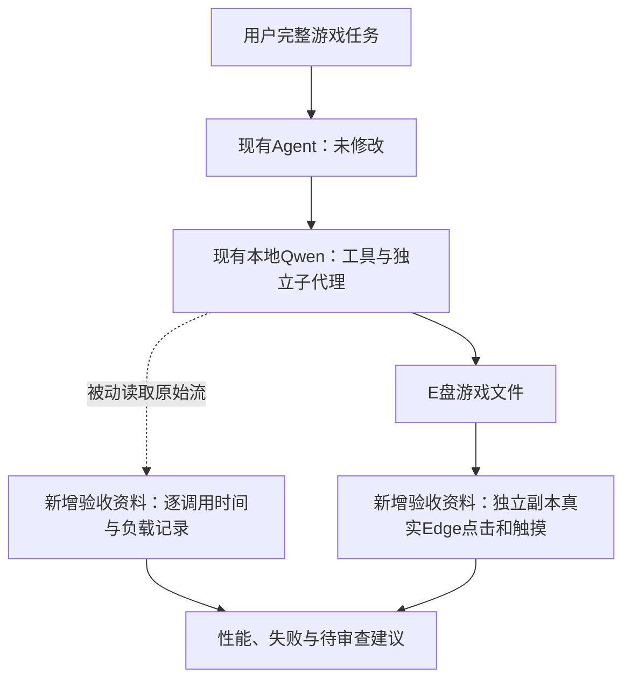
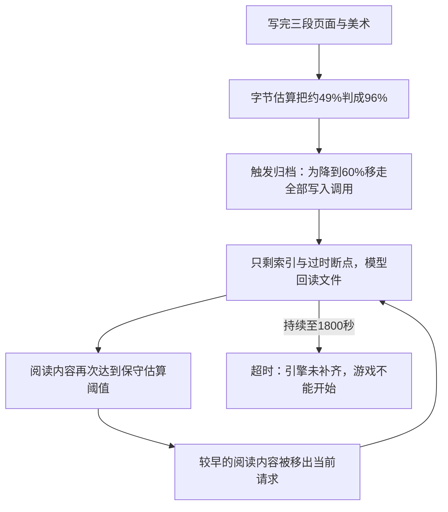

# 2026-10-23：E盘游戏长任务与高负载速度测试

用户要求先测试，再提交改进想法，待用户审查后决定。**本轮没有修改Agent源码、系统提示、工具契约或执行策略，没有自动追加第二轮游戏或修复产物，也没有提交/上传。** 仅按用户要求将本地保存的工作区设置到`E:\game`，增加验收现场和本说明。

## 本轮解释图

模型选择了单文件HTML、一个子代理的计划。没有强制替换它的方案。模型请求观察器只统计原始SSE时间，包含文本、推理和工具参数；不增加模型请求、不改响应、不插入审查或重复拦截。运行日志通过`E:\game\.clearact`目录联接实际集中保存到本轮development记录目录。

完整逐文件职责见[本轮树](2026-10-23-game-load-tree.txt)，当前模块表与主流程见[ARCHITECTURE.md](../ARCHITECTURE.md)。本轮模块总表中Agent各模块均未修改；新增内容只有验收记录和文档。

## 测试条件

- 原任务：`development/fixtures/large-visual-novel.txt`，保持三个背景、三个角色与表情、三处选择、两个结局、约十分钟剧情和完整交互要求，没有缩小目标。
- 工作区`E:\game`；原始配置及源码哈希：`development/records/evals/game-load-20261023-161653/configuration.json`。
- 本机模型`qwen/qwen3.8-27b`，接口`http://localhost:1235/v1`；上下文100096，输出上限16384，阈值/目标0.9/0.6，温度0.1，思考none。无云端模型。
- 本轮单独允许1800秒，网关原600秒总超时未改；因此不能与此前900秒试验直接当作等条件优劣比较。
- GPU/系统内存每约5秒采样，未隔离其他应用；GPU纯解码、未缓存输入token与独占显存峰值没有被直接测量。

## 实际结果

- 执行状态：`failed`，1800.031秒，主子总调用280；错误`TimeoutError: `。
- 独立开始游戏检查：False。电脑真实鼠标、手机真实触摸；原结果`development/records/evals/game-load-20261023-161653/independent/first-play.json`。整体游戏验收**未通过**，没有用注册文件或正常HTTP响应替代验收。
- 文件写入3次，最后写入后又发生269次工具调用；工作断点1份，其后已有3次写入，但断点未跟进。
- 上下文归档39次，容量截断续跑0次，工具错误事件2条。
- 最终index.html为54368字节；电脑点击和手机触摸均报`VN is not defined`，核心引擎未定义，游戏无法开始。完整路线、存读档与声音因此未继续冒充通过。
- 两次工具错误均来自file_list传入绝对根路径E盘game目录，被通用文件路径校验拒绝；改用点号后成功。这是目录根路径接口兼容问题，原始错误见tool-errors.json，未修改实现。
- 最终产物、字节数和哈希见generated-files.json；保留全部原始消息、模型响应、父子记录、快照与失败。

- 读文件调用269次，为这些调用生成指令的模型请求共耗时1383.63秒；file_read工具本身的事件计时中位数0.001秒（含记录开销），两者不能混为磁盘速度。
- 外层测试到时导致子执行被取消；子记录的统一取消文案可能写成用户停止，本轮没有用户手动停止操作。

## 输出速度与负载

| 指标 | 实测 |
| --- | --- |
| 较长输出样本数（≥256 token、流阶段≥1秒） | 4 |
| 较长输出加权近似速度 | 82.537 token/秒 |
| 较长输出速度 最小/中位/最大 | 65.845 / 83.01 / 85.588 |
| 所有调用首段等待 最小/中位/最大秒 | 0.571 / 3.447 / 16.962 |
| 单次服务实报输入最大值 | 32504 token |
| GPU利用率 中位/最大 | 99.0% / 100.0% |
| GPU显存采样最大值 | 23456.0 MiB |
| 系统内存采样最大占用 | 99.0% |
| 归档后下一请求首段等待中位数 | 14.686秒 |
| 其余请求首段等待中位数 | 3.017秒 |

速度为服务实报输出token除以首末有效流片段间隔，是近似端到端流速度；短回复不纳入长输出统计。首段等待含网络、队列和预填充，缓存未控制，相关性不能直接当成归档导致等待的因果证明。Agent游戏轨迹未覆盖接近100k上下文的持续长输出；单独服务探针另表统计，不能宣布满窗口Agent任务完成已验证。

累计用量：{'input_tokens': None, 'output_tokens': None}；服务已实报的小计为{'input': 5909741, 'output': 45751}，未知用量调用为[280]。小计不是完整总量，输入是多轮累计，不是独立上下文或未缓存计费量。

## 独立模型服务速度探针

主任务结束后顺序发起两次直接服务请求，输出上限仅在探针中设为1024。不是Agent运行，不卸载/重载模型；不能算游戏验收。每档仅一份样本，缓存未控制。

| 服务实报输入 | 实报输出 | 首段等待秒 | 近似流速度token/秒 | 结果 |
| --- | --- | --- | --- | --- |
| 16077 | 1024 | 15.155 | 88.853 | length |
| 80077 | 1024 | 79.214 | 63.97 | length |

完整原始流、实报用量和负载保存在capacity-speed/。达到探针预设输出上限是测量条件，不是游戏任务截断恢复成功。

## 发现与待审查建议（尚未实施）

1. **优先修复归档与续写状态的衔接。** 当前断点仍是刚开始的描述，写入后的具体进度没有进入断点。建议从已发生的写入事件保留最新字节位置、已完成块和剩余工作；不让过时断点成为唯一工作状态，不添加验收模型。
2. **去掉泛化回读提示，保留定位信息。** 当前归档索引包含`Read current files before editing.`，但最近文件表仅保留路径/哈希/事件号，没有追加所需的字节数。这可能强化整文件回读，应改为携带已有写入元数据，允许模型直接续写所需位置。没有做隔离对照，不能断言此提示是唯一原因。
3. **改善容量估算与工作集保留。** 目前UTF-8字节保守估算与服务实报token有差距，在实际窗口尚有余量时就反复归档。建议用实报usage校准，并保留最近工作事务；维持用户原要求与原始记录，不靠删除要求来省token。
4. **调整模型计划的引导，先留下可运行核心。** 本轮先堆积美术，核心脚本与剧情未完成。建议计划中明确引擎、剧情、美术职责，优先可运行闭环，SVG用符号和参数复用；仍由模型选工具，不新增强制文件数、搜索配额、重复检测或自动修复轮次。

建议先审查第1、2项这一处“压缩后继续写”的改动，完成后再决定是否校准估算和调整计划提示。本轮不改LM Studio配置、不引入额外审查或重复拦截。

## 验证边界与记录

没有业务源码变更，未把历史47项回归算作本轮新验证。完整路线、结局、读档、声音、素材观感和十分钟实际游玩未通过独立验收；开始环节失败时后续标为阻塞，不能宣传复杂长任务已解决。

所有现场位于`development/records/evals/game-load-20261023-161653/`：evaluate.py（本轮入口）、configuration.json、goal.txt、console.log、calls.jsonl、telemetry.jsonl、runtime/、父子report、run.json、generated-files.json、performance-summary.json、performance.png/svg、independent/及源码一致性结果。原始失败不覆盖。

一条只读分析查询曾将SQLite表列写成branch_id而失败，已按实际表结构修正；这属于验收分析脚本失误，不是Agent运行错误，未向模型发送反馈或重跑任务。

## 后续根因定位：冻结记录回放与一次决策对照

本节是在上一轮结果基础上的进一步定位，不是新的完整游戏验收。Agent源码、游戏产物与原始运行JSON均保持不变，核对哈希通过。离线还原了全部276次子代理请求，消息字节数、消息数、工具数及投影估算与原记录全部一致，差异0。

### 1. 第一次归档并非真的接近100k窗口

对第一次归档前保存的完整messages/tools发起受限本地探针，服务实报输入为 **32765 token**。加上原游戏预留16384输出，真实占用约 **49.1%**；原程序把JSON的UTF-8字节数加固定开销当作保守token估算，输入估到79838，加输出后为 **96.1%**，于是提前触发90%归档。

这个实报输入来自还原请求的直接测量，不是拿游戏轨迹中已发请求的最大值猜测未发送的归档前请求。计数探针输出上限512，与原游戏不同；messages/tools保持同一快照，原16k输出预留只用于评估它原本能否装下。

### 2. 为达到60%目标，把最近的写入工作集也全部移走了

| 归档截止位置 | 估算输入 | 含原输出预留的估算占用 | 保留的完整写入调用 |
| --- | --- | --- | --- |
| event 0 | 79838 | 96.1% | 3 |
| event 66 | 79392 | 95.7% | 3 |
| event 78 | 69376 | 85.7% | 2 |
| event 90 | 47238 | 63.6% | 1 |
| event 102 | 16692 | 33.0% | 0 |

归档按完整工具事务切块。到event90时仍保留最后一段写入，估算占用63.6%，高于目标60%；继续移走最后一段后降到33.0%，三个写入调用全部离开当前消息。原日志没有删除，但模型当前请求里已经没有刚写过的源码与相关叙述。

**对上一节建议的补充纠正：**第一次归档后的recent_archived_receipts仍包含54368字节和哈希。因此“完全不知道文件字节数”不能解释第一次转向回读。文件元数据不够持久仍值得修正，但不是此次失败的完整原因。更关键的是工作内容被替换成索引，而唯一工作断点仍声称刚开始、目录为空。

### 3. 恢复阅读本身又不断被归档

第一次归档后，模型先读开头200字和末尾，再倒着分页读已有SVG。第二次归档时，当前保留的完整阅读内容从44435字降到15000字。

到子调用21（全局25）之前，它历史上已经累计读过整份54235字文件，但当时当前请求仅保留25000字完整阅读结果，下一步又去读已经读过的25000字位置。之后当前请求中完整阅读内容最多只有40000字，没有同时保留整次扫描。

这不是说必须把整个文件放回上下文才能写程序，而是说明它选择的“整文件回读恢复”路径，在现有投影下不能稳定累积。归档索引只有短摘录与坐标，没有把这次恢复过程整理成可继续的工作状态，也没有更新旧断点。结果是269次回读、39次归档，最后耗尽时间。

### 4. 相同进度的下一步对照支持投影导致转向

两种条件均使用同一个本地模型、相同工具、温度0.1及512输出上限；不执行模型返回的任何工具，不写游戏文件。只替换归档前/归档后的原始请求快照。

| 条件 | 输入token | 模型下一步 |
| --- | --- | --- |
| 保留原完整上下文 | 32765 | file_edit，并表示继续添加剧情数据；因诊断输出限额而截断，未执行 |
| 使用原归档投影 | 4094 | file_read，读取index.html开头200字；与原失败轨迹一致 |

这是一组下一步决策样本，支持请求投影影响了执行方向；没有固定seed，也没有完成整款游戏，不能宣称保留上下文一定能把游戏从零完成。完整投影的对照也没有隔离“编辑前回读文件”这句话，不能将它单独认定为唯一原因。

### 5. 其他因素与修复范围

- 本轮主代理把整款单文件游戏交给一个子代理，主要工作压力集中在子代理，实际没有分成引擎、剧情、美术等较小任务。
- 用户原任务要求先做可运行核心，本轮却先写美术；这使超时产物完全不能开始。但它不能单独解释归档后立即进入回读，所以属于计划与交付顺序问题。
- 两次绝对根目录file_list错误随后已恢复；写入成功、模型持续返回请求，不能将它们当成23分钟回读的原因。
- 30分钟时限是最终停止条件；提高时限没有修复循环。原游戏没有发生输出容量截断，不能归因于16k输出不够。
- 归档后首段等待中位约14.7秒，其他请求约3.0秒；缓存未控制，属于相关性。大量模型请求在决定读文件，而file_read工具本身中位约1毫秒，主要耗时不能归为磁盘读取。

**应先修正容量判定与工作集连续性这一条链。**准确度改善不能替代真正到限时的安全整理；新的归档必须保留能继续执行的最近工作信息，并避免让过时断点取代当前进度。之后再审查任务拆分与核心优先顺序。无需通过新增审查模型、重复检测、搜索配额或自动补救轮次来掩盖这个问题。本次仅定位，未实施业务改动。

全部还原请求、候选截止点、对照原始流、用量、哈希核对及结论位于`development/records/evals/game-load-20261023-161653/diagnosis-20261023-170028/`。
