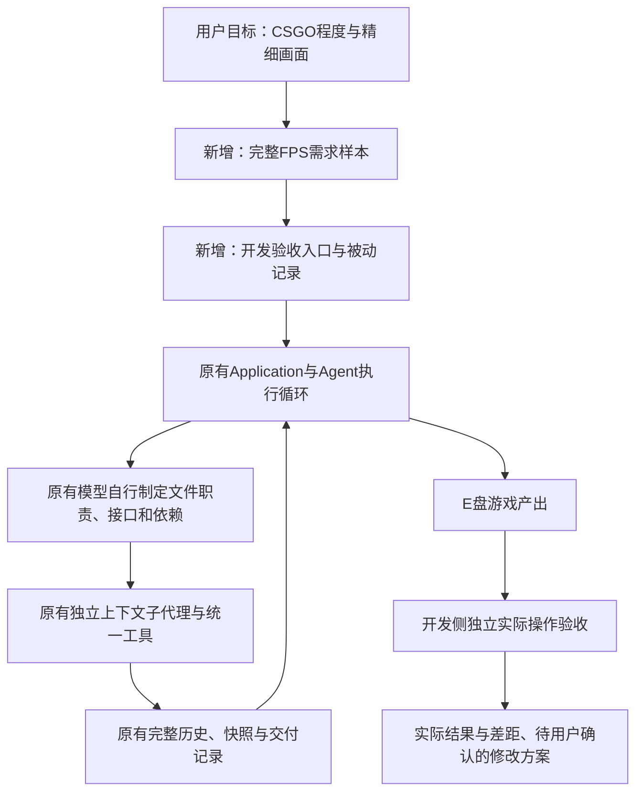
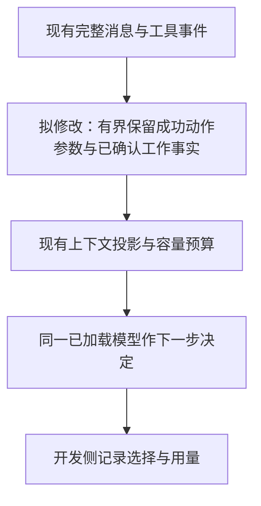

# 2026-10-25：CSGO质量目标的真实FPS大任务尝试

用户要求先用现有Agent在已清空的E:\game尝试制作游戏，检验任务拆分；失败后先提修改方案，经确认再改Agent。本轮不修改src中的Agent代码，不向运行中的Agent发送独立验收反馈，不手工补写游戏源码。

## 本轮解释图

新增内容仅为development下的需求、测试入口和本轮记录；运行架构及公共契约不变。完整文件树保存在同目录2026-10-25-fps-attempt-tree.txt。

## 运行约束与参数

- 已只读确认本地qwen/qwen3.8-27b在线且加载上下文100096，不卸载或重载模型，不使用云端模型。
- 本次输入窗口100096、单次输出16384、温度0.1、reasoning_effort=none，自动归档90%/目标60%，容量续跑开启。
- 单次模型请求时限360秒，本次整轮上限3600秒；仅测试覆盖，未改变用户保存配置。
- 开始前记录E:\game为空。Agent在这里自行写文件及.clearact运行数据；开发验收资料放development/records/evals/fps-attempt-20261025-135936。
- 运行前保存全部44份运行文件哈希；本轮不修改Agent，不提交或上传。密钥仅在内存用于本机请求，不输出或复制私有配置。
- CSGO是原始质量目标；单人射击原型或功能冒烟通过不能记作达到完整商业游戏品质。实际多人、地图、资产、动画、AI和交互分别报告。

## 实际任务拆分

初始模型自行制定core、map-detail、weapons-ai、hud-menu、audio-polish五项任务及公共JS接口。core承担14个文件，范围仍较大；保留该原始分配，开发人员不重写任务计划。执行顺序、工具选择和普通错误后的修正均由现有模型决定。

## 本轮实际文件变化

| 文件或板块 | 状态与职责 |
| --- | --- |
| development/fixtures/large-tactical-fps.txt | 新增，实际发送的完整需求；原用户文字另存现场 |
| development/scripts/evaluate_tactical_fps.py | 新增，走现有Application执行一次任务与人工停止观察器 |
| development/scripts/evaluation_observer.py | 新增，从既有现场抽出的被动SSE计时与整机采样，8个函数/类AST等价，不被Agent导入 |
| development/scripts/verify_tactical_fps.py | 新增，在冻结副本上用真实键鼠与只读状态检查功能、保存截图 |
| development/tests/test_evaluation_harness.py | 新增，回归开发侧误await同步stop导致导出中断的问题；不调用真实模型 |
| development/docs、records | 本轮解释图、完整树、失败、用量、性能、独立断言和待确认方案 |
| src/clearact_lite、公共契约 | 本轮未改，全部44份运行文件与开始前哈希完全相同 |

## 最终结果：未达标，未正常完成交付

| 项目 | 实际结果 |
| --- | --- |
| 父运行 | stopped，开发人员人工停止；2593.375秒，约43分13秒 |
| 模型调用 | 545次尝试，544次有完整用量，最后第545次人工取消，用量未知 |
| 实报小计 | 输入23,421,435 / 输出116,612 token；完整累计仍为null |
| 子代理 | 五项均正常返回，但游戏独立验收失败；正常返回不代表功能正确 |
| 文件 | 14份游戏源码，共118,331字节；正式登记交付0项 |
| 输入容量 | 单次服务实报最大71,377；2次归档，0次输出截断续跑 |
| 文件读取 | 516次工具读取，其中290次请求不超过256字符，中位请求长度200字符 |
| 首次打开浏览器 | 任务开始后2256.512秒，约37分37秒；核心和其他子任务均已先返回 |
| 长输出速度 | 45个≥256输出token且流阶段≥1秒样本，加权近似72.055 token/秒；范围57.226–78.760 |
| 整机负载 | GPU利用率中位88%，显存中位23,223MiB；系统内存中位91.3%、最大98.5%，每5秒采样 |

累计输入是多轮请求的累计，不是独立上下文长度、未缓存token或云端计费量。未知值不补0。速度口径为服务completion tokens除以首末有效SSE帧间隔，包含工具参数，不是GPU纯解码或整轮有效游戏产出速度。缓存、其他全机进程及浏览器GPU负载未控制，不能用单样本宣称参数最优。

子任务实报（不与父运行累计重复相加）：

| 子任务 | 调用 | 秒 | 输入小计 | 输出小计 | 状态 |
| --- | --- | --- | --- | --- | --- |
| core | 53 | 388.203 | 1,459,727 | 23,161 | finished，未代表验收通过 |
| map-detail | 22 | 203.734 | 609,199 | 11,103 | finished，未代表验收通过 |
| weapons-ai | 102 | 419.547 | 4,388,844 | 19,840 | finished，未代表验收通过 |
| hud-menu | 142 | 551.250 | 7,926,313 | 26,027 | finished，未代表验收通过 |
| audio-polish | 16 | 233.187 | 588,732 | 12,577 | finished，未代表验收通过 |

父代理自身210次调用，已知输入8,448,620、输出23,904，另有最后一次未知。五个子上下文确实独立运行；主代理随后又大量回读源码，父输入最大71,377。因此“已经调用子代理”不足以证明上下文使用高效或产物可玩。

## 独立真实操作验收

使用冻结副本，Edge 1440×900、硬件ANGLE/NVIDIA RTX3090/D3D11；不跳转玩家位置、不强制扣血/结局、不修游戏源码。两轮独立操作结束后原游戏哈希均未变。跟进轮仅补测四方向与声音实际状态，保留首次失败；没有将独立反馈再发给Agent。

| 检查 | 结果与界限 |
| --- | --- |
| 启动与运行异常 | 能显示真实三维场景，无独立页面脚本异常；不表示所有功能正确 |
| 真实W/A/S/D | 每键按住800ms，Game.Input均收到true；玩家始终为[0,1.7,30]，四方向均不移动，失败 |
| 鼠标与射击 | 真实鼠标改变视角；按住射击后弹夹12→10；没有把耗弹当作实际命中敌人 |
| 换弹 | 真实R按键后10→12，备用48→46，通过这一项 |
| 武器切换 | 1–5键实际观察到4种武器：P-9 Pistol, AK-47 Rifle, M-870 Shotgun, AWM Sniper；第5键没有新增可切换武器 |
| 武器显示 | 相机下有11个武器网格，相机不属于实际渲染场景；单场景渲染时武器不可见，截图也未出现，失败 |
| 声音 | 点击后enabled由true变false，但标签仍Sound:ON；退出指针锁后复开操作本轮仍为false，未完整通过 |
| AI、战斗、回合 | 观察到AI位置变化；独立真实命中、伤害与完整比赛胜负/重开未验证，不能用Agent直接扣血的状态测试替代 |
| 画面与目标 | 实际场景181个网格、0张材质贴图；以块体建筑、箱桶与基础光照为主，细节和资产精度明显不足。未实现CSGO级多人联机、内容规模和战术玩法，不达目标 |
| 语法 | Node对12份JS检查通过；这是语法通过，未证明坐标、渲染或游戏语义正确 |

RAF频率记录只是浏览器回调节奏，不计为游戏实际呈现FPS。素材数量不直接代表美术质量，画面结论同时依据实际截图。任务的完整验收为未通过，不能用部分控制或语法通过覆盖失败。

## 可确认的问题与尚未证明的因果

1. **碰撞坐标错误。** player.js直接使用geometry.boundingBox，未应用物体世界变换。实际位于x=±40的侧墙，其局部x约[-0.3,0.3]被当作世界坐标，错误拦住出生点x=0。独立输入与局部/世界包围盒对照同时证明这一问题。核心子代理最初的map.js已经返回Mesh，因此不能说这是后续地图子代理才引入的类型变化。
2. **武器没有进入渲染树。** engine.js只render(scene,camera)，没有把camera加入scene；player.js把武器挂到camera。实例实际相机不在scene且其下有11网格，与空武器截图相符。
3. **分配遗漏调用方。** weapons-ai想改js/player.js、hud-menu想改css/style.css、audio-polish想改js/menu.js，三次均越出模型自己分配的文件范围，被现有边界拒绝。Agent边界规则未新增；模型计划与交接需覆盖调用方、共享文件及未落实事项。
4. **归档确实丢失了当前接口事实。** 第二次归档前使用getEntities的真实浏览器操作仍成功；离线重建消息投影中getEntities出现23次，归档后变为0。当前索引保留path/offset等参数，却未保留browser_action的action/value脚本。第二次归档后开始使用不存在的Game.AI.list，连续59次错误；is_error=true与TypeError已正确回传，不能归因于没有错误反馈。信息移除是已证事实，是否补回就足以改变模型选择仍需固定上下文对照。
5. **本次不是窗口溢出或单次输出不足。** 两次归档前的上次实报输入分别68,882、71,377；下一请求预测输入73,845、73,832，再加16,384输出预留约90.1%。上次实报和下一请求预测不是同一次请求，不能直接当作精确误差。归档后的下一次实报13,627、13,916，模型继续正常响应，没有卸载/重载或容量服务错误。0次输出截断，当前没有依据仅靠提高输出上限解决这些问题。

原始运行、归档、完整投影重建、工具错误、所有子消息、快照和截图均保留。离线投影重建为了核对词语保留，省略工具Schema，不用于比较token估算；没有新模型请求。

## 开发侧脚本错误与收尾

人工停止标记由开发人员写入，既有Application.stop同步取消成功，Agent真实保存stopped结果。验收脚本误await返回bool，导致后续导出/清理流程中断；这是开发脚本错误，不是Agent停止接口变更。原始console.log、evaluate-as-run.py和run.json保留，未重写成成功。

已仅在development修正调用，并用一个无真实模型的取消回归用例验证：1项通过、0.56秒。禁用pytest缓存插件出现cache_dir配置警告，断言通过。没有重新运行43分钟生成任务。随后从只读SQLite导出5300个事件及545条调用指标，数据库与WAL哈希未改，保留最后一次未知用量；全部运行数据另存runtime副本。CLI初次漏设PYTHONPATH的失败、后续成功和静态检查均单独保留。

被动观察器后续抽为维护模块，8个函数/类的AST与本次运行的旧观察器相同；本次实际脚本以evaluate-as-run.py为准，不拿维护版行号解释旧运行。Agent本体44份哈希均未变，保存配置未变，无提交或上传。

## 待用户确认的修改方案：尚未实施

建议先只做第一批，不把所有能力一起扩展。

| 批次 | 建议与明确范围 | 如何验证 | 当前状态 |
| --- | --- | --- | --- |
| A：归档保留工作事实，优先 | 修改context.compaction的事实索引及必要的builder配套：保留近期成功工具的有界完整参数，尤其action/value与结果坐标；将当前已确认接口、进行中的整合与文件版本一起带入。继续保留原始消息，不加额外总结/审查模型或重复检测 | 先离线验证同一归档点保留getEntities及协议完整；再以同一失败上下文、同一模型参数对照原版与候选版的下一步选择，只保存响应、不执行工具；不注入正确函数名，不把短对照算作大任务成功 | 待确认，未改src |
| B：把项目接口写完整 | 在模型文件计划/交接说明中要求写明返回对象、世界/局部坐标、毫秒/秒、调用方与未落实改动；沿用TaskPlan.interfaces和现有公共契约，文件数、工具及顺序仍由模型决定 | 用新隔离游戏检查出生点移动、武器实际显示及真实回合；保留错误和用量 | 后续独立批次，未实施 |
| C：完善模型可用的真实开发能力 | 原生持续按键/鼠标移动/按住射击；按需将截图作为模型可见图片；按需本地命令用于启动和语法/类型检查。分别通过现有BrowserPort、统一消息/工具契约和工具注册接入，按子批次评审，避免接口各造一套 | 原生输入对照实际状态；真实本地视觉输入；命令超时/停止/输出记录。模型自行决定调用，不运行自动验收补救循环 | 后续能力建议，未实施 |

拟议A批次的解释图（不是当前已修改架构）：

参数方面，本轮100096/16384与加载容量一致，未遇输出截断；先保持这两项。是否使用少量思考可在归档对照收敛后，另用相同失败上下文比较none与低档位，避免同时改变归档和模型参数而无法判断作用。不宣称当前设置是全局最优，也不承诺上述修改会直接生成CSGO级资产、联机和完整商业游戏。

## 结构与证据入口

Agent本体和公共接口本轮不变。完整逐文件职责树见本目录2026-10-25-fps-attempt-tree.txt；总架构见../ARCHITECTURE.md。游戏14份源文件的职责为：index.html入口，css/style.css基础样式，js/main.js整合与循环，engine.js渲染，input.js输入，player.js玩家/碰撞，weapons.js武器，ai.js敌人，round.js回合，hud.js信息显示，menu.js菜单，audio.js音效，map.js地图，utils.js数学辅助。游戏保留失败原样。原型入口为E:\game\index.html，可用浏览器打开；Three.js来自unpkg CDN，需要可访问网络。Agent自测使用工作区HTML，独立验收使用冻结副本的本地静态服务。

本地证据目录：development/records/evals/fps-attempt-20261025-135936，主要入口：

- run.json、report.json、child-*.json、calls.json[l]、runtime/：真实状态、完整父子历史、原响应、快照、未知用量。
- diagnosis.json、browser-actions.json、archive-2-projection-word-retention.json、archive-memory-*.txt：分配、读取、错误与归档事实。
- independent/independent.json、independent-followup/followup.json及截图：冻结副本真实输入，全部失败保留。
- performance-summary.json、performance.png、telemetry.jsonl：用量、速度及负载，缓存未控制。
- export-recovery.json、console.log、stop-harness-test.txt：开发脚本错误、只读恢复及无模型回归。

这些现场只在本地，Git克隆不会自动带来它们。没有再次模型生成或手工修游戏来掩盖本轮失败。

