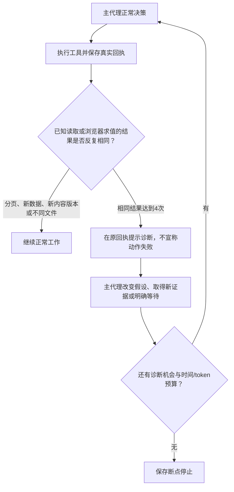

# 2026-10-27：检查结果不变也使用同一个补救预算

这是前一批可靠性实施的补充，来自游戏真实失败，属于用户已授权的检查/主代理审查/有限补救范围。没有增加独立审查代理、任务领域分类或模型调用。前一批和失败现场均保留，不覆盖为成功。

## 真实触发原因

第一轮新FPS重试为stopped，测试人员手工停止。138次模型请求，137次有完整用量；已知小计输入3204130、输出48063，最后取消未知，整轮usage仍为null。三个子任务已交回，后两项未执行。主代理最后不断给坐标增加小数位，工具成功返回，但弹药0、敌人状态不变。原保护只处理报错，没把这种检查纳入同一预算。

这不是一次成功任务。完整现场 `development/records/evals/reliability-repair-20261025-153523/fps-retry-2026-10-27/`，停止后游戏和完整历史复制到 `game-after-first-retry/`，新增修改前源码在 `before-check-budget/`。

## 修改解释图

## 实现和边界

- 扩展同一RecoveryState，增加observations和started_event_id；不另造检查控制器。计数和预算持久化，归档/截断/取消不清零；投影只传反复出现的观察，完整计数仍在历史。
- 已知读取工具使用完整参数作为键，保护不同文件、分页和不同定位。浏览器evaluate以原始结果内容指纹为依据，允许发现“参数变了、证据仍原样”的情况。只使用精确结果和已知工作文件内容版本，不分析游戏变量或任务意图。
- 默认unchanged_result_limit=4（Settings和HTTP一致）。第4次在同一次工具回执内提示诊断，不额外请求模型；其后两次没有新观察，使用同一blocked_rounds兼容计数并暂停。该计数现在表示已用无进展诊断机会，包括被阻止的原样错误及执行后的不变观察。
- 新观察或新内容允许继续，不清零当前问题的整体600秒/32768输出token预算。resolved声明必须引用新成功证据，不能拿正在反复出现的相同结果本身作为恢复证明；模型声明仍不是独立验收。
- 明确browser wait清除当前浏览器观察连串，支持正常异步轮询；不会清掉已启动的整体问题预算。其他未知外部服务不套用这一观察规则；MCP副作用、文件写入等不因为都返回OK就认定停滞。
- 读取与浏览器结果相同不等于副作用没有生效；这是有限诊断的技术信号，可能需要主代理核对实际状态，不是完整语义判断器。字段每次变化但实际上无意义等情况不一定识别。
- 正常写工具不再为了此机制逐次读取所有工作文件；只在需要的失败版本/已知观察处核对内容，减少多余开销。

## 验证

最终完整回归 **71项通过，9.73秒**；Ruff及前端Node语法检查通过。包括：成功检查的参数持续变化但证据相同仍在6次执行内停止；显式等待、不同文件与分页不误停；刚才真实失败的原始调用/回执离线回放在6次内停止。离线回放使用协议替身，不宣传为真实模型通过；缺少本地失败现场的clone会跳过该本地回放，其他回归保留。

最终本地模型小任务复测及同分支FPS续跑单独归档。续跑不是从零一次成功，旧失败不清除；完整游戏仍需独立真实键鼠验证及质量差距说明。

## 本轮最终实测结论

**Agent的有界停止已在真实模型续跑中触发，完整游戏任务仍未通过。** 后续没有继续修改Agent或手工修游戏。

| 项目 | 结果及边界 |
| --- | --- |
| 最终完整回归 | 71项通过，9.73秒；Ruff、前端Node语法通过。cache_dir警告如前保留 |
| 最终真实数据样本 | 5次调用/16.266秒；输入17875、输出263；独立合计核对通过 |
| 最终真实浏览器恢复样本 | 7次调用/32.531秒；输入28787、输出649；错误接口后找到有效接口并正确交付 |
| 第一次从零FPS | 1164.297秒，138次请求（含3个子任务），测试人员因无效成功检查循环手工停止；最后取消usage未知 |
| 修复检查预算后的同分支续跑 | **134.14秒、27次调用，Agent自行返回stopped并保存断点**；第25次请求后进入诊断，后两次仍返回相同观察，主动止损；输入1259799、输出2752 |
| 两轮游戏合计 | 165次尝试，已知小计输入4463929、输出50815；1次取消未知，完整总量保持null。两轮完成范围不同于旧基准，不能按用量少直接宣布效率提高 |
| 压缩/截断覆盖 | 两轮实际未触发，最大服务实报输入49725；本轮不能用游戏测试宣称90%边界或输出续跑真实通过，仍区分回归及旧投影测试 |
| 第一轮长输出速度 | 服务输出至少512token、流持续大于2秒的20个样本；加权约62.75token/秒，中位73.05，43.39–78.15。被动SSE近似，非纯GPU吞吐 |
| 第一轮整机负载 | GPU利用率中位89%、显存峰值22875MiB、RAM峰值98.7%；浏览器和其他进程/缓存未完全控制，不据此给出“最优参数” |
| 源码与运行条件 | 两次运行期间Agent源码哈希无变化；100096窗口/16384输出/none/0.1，本地Qwen已加载，未卸载或修改保存配置 |

独立Edge在冻结副本上的结果：

- HTTP启动、真实鼠标锁定、W移动、鼠标瞄准、开火消耗弹药、R换弹、1/2/3武器切换通过，没有页面脚本异常；独立新开的file://页面也完整加载了所有模块。
- 场景88个mesh、6个纹理，武器随相机可渲染；有简单材质和区域，但画面仍为基础几何原型，不能认为达到CSGO精度。记录中的约180Hz为RAF回调频率代理，不是实际渲染帧率。
- 自然对抗后玩家死亡、败局和0:1计分出现。**重开点击未通过**：首次以及增加正常Esc操作后的复测均被菜单遮罩拦截；两个失败均保留，未强制点击或直接调用游戏重开。不能把第一次失败简单归咎于遗漏Esc，原因本轮未进一步定位。
- 独立玩家命中、胜利和完整比赛链路未验证。模型曾把射击不命中判断为游戏bug，但它当时的强制位置/内部函数测试不能证明真实玩家射击失败，本轮不将其当成已证实根因。
- round-hud与polish子任务未执行，声音开关、完整回合目标、队伍/联机、商业资产精度与完整交付均未完成。不把子任务finished、基础控制冒烟或止损成功计为任务完成。

续跑时模型观察到Map/Player/AI未加载并反复注入脚本/读取空错误数组；独立新开的HTTP与file页面均能完整加载同一份源码。原工具没有保留最初页面脚本/资源错误，差异原因未定位，不能直接定性为源码、网络或Agent浏览器故障。

**建议下一步先补浏览器工具的原始页面/资源加载错误和就绪事实，再收紧生产模块与调用模块的接口交接；暂不追加更多审查规则。** 这属于后续建议，本轮未直接实施。

最终汇总 `development/records/evals/reliability-repair-20261025-153523/final-result.json`。第二轮完整事件/模型原始响应/断点在 `fps-continuation-v2-2026-10-27/`，独立控制、file复核和两次重开检查分目录保存。原始E:\game备份及第一轮失败继续保留；当前E:\game保留模型生成的未完成游戏，没有手工修改。

完整职责树见[本轮树](2026-10-27-check-budget-tree.txt)，总体流程见[ARCHITECTURE](../ARCHITECTURE.md)。
