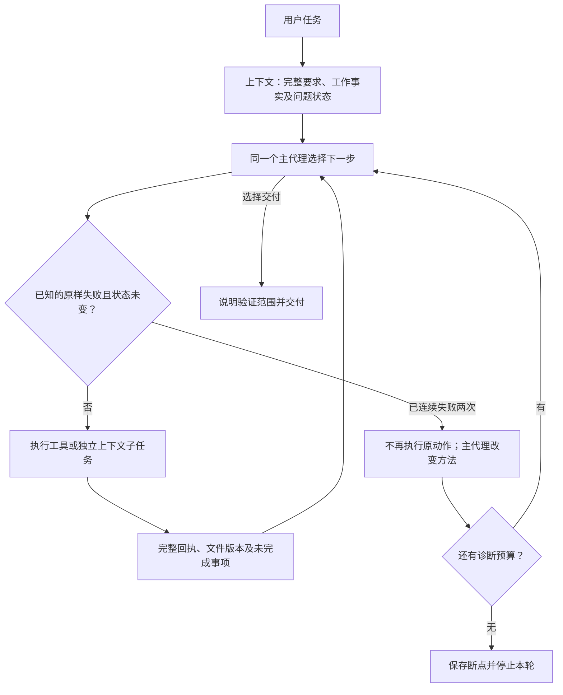

# 2026-10-27：归档事实、有限诊断与主子交接

本文件记录第一批实施。真实游戏随后暴露成功检查循环，已在同一授权范围补齐共享预算；最终源码、71项回归、真实续跑止损与**游戏仍未通过**的结论见[补充报告](2026-10-27-check-budget.md)。以下保留第一批的逐阶段事实。

用户已明确授权实施可靠性计划，再重新尝试E:\game射击游戏。旧项目只读；修改前源码、文档与测试快照在 `development/records/evals/reliability-repair-20261025-153523/before/`。该现场名称沿用先前准备时的名称，实际实施日期为2026-10-27。

## 修改解释图

检查与修复在原模型决策轮次中发生，不增加常驻审查代理。主代理在交接、集成、实际失败和交付时选择相关检查；程序不宣称能判断所有领域任务是否真正完成。

## 模块与影响

- `core/contracts.py`：增量增加ToolFact与RecoveryState。ToolResult.error_kind默认unknown，旧构造兼容；统一事件保存补救预算与原文坐标。
- `context/compaction.py`：成功工具事实按工具/动作保留近期两条，总计最多16条，包括action/value、结果摘录、原文坐标；源码正文仍留历史。原文摘录不等于语义无损压缩。
- `runtime/reliability.py`：新增技术性失败签名、内容版本、补救预算与止损，不调用模型或自动重放。只强拦截已识别的validation/deterministic错误；未知/网络暂时性错误由模型决定重试，仍受预算与原超时限制。
- `runtime/runner.py`：所有主子工具循环共用保护，记录是否实际执行；被阻止的动作也闭合消息事务。预算用完返回stopped，error明确Recovery paused，保存运行时断点。
- `runtime/delegation.py`：交回成功事实、原分支、未完成断点及同一RecoveryState。子代理可靠性暂停交回主代理；用户停止继续传递到整轮。相同计划任务重试继承原补救状态，不能换子分支清零。
- `tools/tasks.py`：计划提示强调接口返回、单位、调用方和相关验证；断点可保存问题、改法、成功标准与证据引用。模型根据成功回执声明resolved仍是模型判断，不是独立验收。
- `settings.py`及HTTP设置契约：默认同样失败2次、2个原样被阻止的诊断机会、600秒/32768输出token的补救预算。输出未知时使用序列化消息UTF-8字节上界并标为估算；不伪造服务usage。高级参数目前通过统一设置/API保留，界面没有新增单独表单控件。
- `web/app.js`：显示诊断、未执行、暂停断点、模型报告恢复；没有额外权限审批。
- `development/`：新增回归、真实模型对照及失败恢复样本；游戏评估继续使用Application与被动采样。

单次普通失败不会立即让长任务进入补救倒计时。重复问题才启动预算，子任务失败交回也启动预算。程序只识别可计算的变化：已知工作文件的真实内容哈希和成功浏览器动作；不能证明任意远端状态未变化，不做完整语义进展判断。相关内容/浏览器动作改变会允许重试，不清零整个问题的时间/token预算。预算在下一决策/执行边界检查，不中断已发生的副作用；仍有原有请求、浏览器、整轮超时。

归档、输出续跑和取消不清零状态。可靠性暂停后，**显式的新用户轮次**可开启新的诊断预算，仍保留原失败签名和此前事件；自动续跑和子代理重开没有此权限。文件快照不承诺撤销外部副作用。

## 验证与未证明事项

首轮完整回归66项通过（10.59秒）；随后补状态变化和单次普通失败误停回归，以最终完整结果为准。关闭pytest缓存插件会出现一条cache_dir未知配置警告，属于开发检查配置。

真实本地Qwen、none、温度0.1：数据去重汇总6次调用/10.875秒，usage输入21336/输出255；浏览器错误接口后自行找到getEntries、读取真实数据并交付，7次调用/14.172秒，usage29115/582。两者独立核对文件值通过；不等于复杂任务通过。初轮真实样本运行时载入的是补充边界修正前的模块，保留初轮原始记录，最终源码的验证另行记录。

旧归档同边界离线投影getEntities从0处变为1处。每个条件一次真实模型下一步对照，两者都选择开始下一轮，未执行工具，**不能得出保留接口已解决旧循环的因果结论**。候选请求输入17029、原版13997，新增事实带来3032输入token成本；不声称已经节省全程用量。

完整树见 [逐文件职责树](2026-10-27-reliability-tree.txt)，当前总体流程与模块表见 [ARCHITECTURE](../ARCHITECTURE.md)。射击游戏重试及独立验收将在本记录更新；尚未运行之前不能宣传为已通过。

最终源码回归：**68项通过，8.04秒**，Ruff及前端Node语法检查通过。冻结源码复测：数据任务6次调用/8.453秒、usage21342/256；浏览器错误恢复8次调用/17.203秒、usage34117/674。独立核对结果值和原输入不变均通过，运行期间源码哈希未改变。最终现场位于 `real-model-final-2026-10-27/`；第一轮及对照失败/不确定结论不覆盖。

射击游戏已于同一批次启动一次真实重试：`fps-retry-2026-10-27/`。旧E:\game完整43文件已复制到 `game-before-retry-2026-10-27/`，原目录和副本逐文件哈希一致后才清空。模型参数沿用100096窗口、16384输出、none、0.1；本次评估整轮3600秒，保留600秒的单个补救问题预算。未修改保存配置、未卸载模型。结果待本轮真实运行和独立验收。
