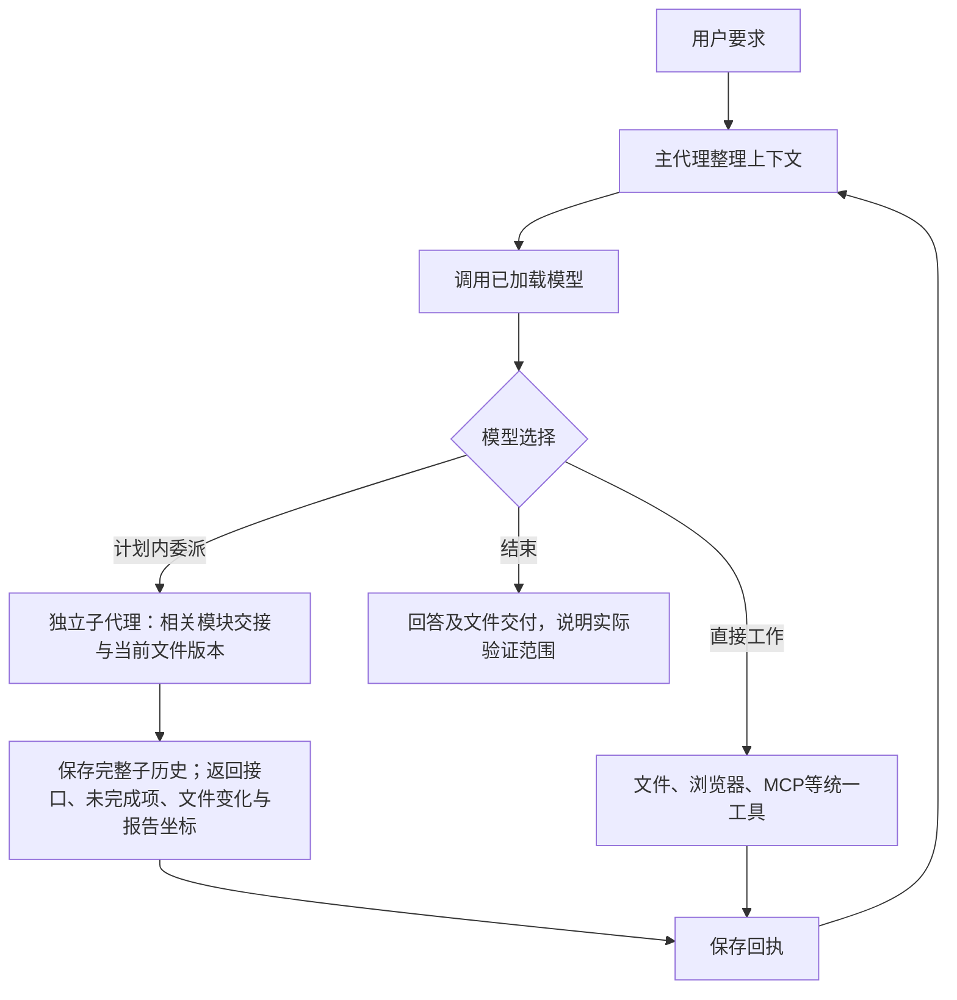

# 浏览器原始错误与模块交接修复：2026-10-28

建议先用这版继续验收复杂任务，观察原始错误与模块交接是否足以推动有效修复；本轮不叠加新审查策略。两个隔离本地模型任务已通过独立浏览器检查，射击游戏复杂任务仍未通过。本轮没有改写 `E:\game`，也没有碰旧项目数据。

## 原因、修改和影响

此前游戏运行只拿到后补监听器产生的模糊错误，页面启动时的脚本/资源错误已经错过；子代理报告仅截取开头，末尾待办会丢失；没有显式depends_on的任务即使依赖同一模块，也拿不到已有交接。这些是通用信息链问题，不能据此认定旧游戏失败就是某个CDN或特定模块造成。

| 板块 | 本轮修改 | 影响与边界 |
| --- | --- | --- |
| core/contracts.py | BrowserDiagnostic、BrowserPageState、InterfaceContract、HandoffFile、TaskHandoff；TaskPlan可选contracts | 公共结构集中，原Application、Port、ToolResult签名及旧计划兼容，schema仍为1 |
| integrations/browser_diagnostics.py【新增】 | 页面创建时保存脚本、console、请求及HTTP错误；导航/标签独立；完整原文与简短回执 | 只被动收证，不增加页面检查、修复、重载或重试；浏览器load不是业务成功 |
| integrations/browser.py、tools/registry.py | 状态和异常附带已捕获证据；保留原异常 | 错误能回到模型而非只在浏览器里；原始stack可按坐标取回 |
| runtime/delegation.py | 首尾报告、结构化接口/未完成项、原文坐标、分配文件前后版本 | 主代理得到事实和模型报告，不能把接口声明当实测正确 |
| tools/tasks.py | 计划/断点可选接口字段共用Schema | 只校验结构和任务引用；不插入依赖、不自动派任务 |
| tools/history.py | 显式交接来源分支只读可访问 | 子代理能取回交接全文；其他父/兄弟分支仍拒绝，不复制整个主历史 |
| context/compaction.py | 归档保留错误观察与交接坐标 | 索引仍是有界事实摘录，不承诺语义完整；旧错误不是当前页面健康状态 |
| runtime/runner.py、web/app.js | 简短使用说明，新事件中文标签 | 复用现有主代理决策和透明记录，无新增审查模型 |
| development | 新增针对性测试及真实本地模型验收入口 | 生产运行不包含这些测试；失败和用量分开留存 |

### 本轮解释图

浏览器工具从页面创建时就监听原始错误，错误随回执进入H；并非在主循环之外另开一套模型或审核流程。既有停止、超时、90%压缩、输出续跑和有限诊断保留，图为突出本轮信息链省略既有旁支。

## 实际验证

记录根目录：`development/records/evals/browser-handoff-20261027-01/`。目录名沿用本轮首次建立日期，最终修复与本说明日期为2026-10-28。

| 检查 | 结果与证据 |
| --- | --- |
| 原始错误/资源失败/导航与标签/重复回执 | 真实Edge两项通过，5.41秒；pytest-browser-2.txt |
| 第一轮交接及原容量/子代理兼容回归 | 25项通过，1.55秒；pytest-handoff-1.txt |
| 首次全回归 | 79项通过，15.65秒；pytest-full-1.txt |
| 最终全回归 | 82项通过，10.94秒；pytest-full-final.txt，覆盖后续失败替换旧成功、共享文件交接及计划接口来源 |
| Ruff与前端语法 | src、全部维护测试及脚本Ruff通过；node --check app.js通过 |
| 真实本地模型：修复启动错误 | 11次调用、22.906秒，服务上报59220输入/793输出token；模型依据ERR_FILE_NOT_FOUND和computeTotal不存在补engine.js，独立新Edge实际输入3并点击得到37.50，无脚本错误 |
| 真实本地模型：两子任务接口交接 | 28次调用（含子engine 4次、ui 9次）、93.031秒，服务上报207420输入/4660输出token；主代理集成后，独立新Edge输入4点击得到50.00，另测小数舍入0.50，无脚本错误 |

真实模型使用本机已保存的兼容服务与qwen/qwen3.8-27b；独立工作区均在上述records内，没有调用云端收费模型，没有改写私有配置，也没有卸载/重载模型。配置、全部原始父子记录、逐次usage、独立截图及summary.json在`real-model-20261028/`。

两个模型任务共39次调用，累计服务上报输入266640、输出5453token；这是跨请求累计，不是单个上下文长度或未缓存计费量。逐次39条usage均完整。计时为整轮耗时，不是GPU推理吞吐。

交接任务实际只有engine声明了结构化接口；ui声明未完成项但没有声明提供接口，记录保持interface_source=none，不能算作两个结构化接口都验证。该任务提示明确要求使用新交接字段，因此证明可用，不证明模型面对任意需求都会自发正确拆分。

### 原始失败和验证版本

- `pytest-browser-1.txt`保留首轮1失败/1通过：验收HTTP夹具缺少根路径健康响应，启动器等待404超时。补验收夹具根路径后再运行通过；这不是Agent应用故障，未改生产启动逻辑绕过失败。
- 首次Ruff在尚未格式化的新测试上报行长，格式化后检查通过。旧的禁用pytest缓存插件命令产生cache_dir配置警告；最终回归使用正常插件，但已有development/.cache/pytest目录拒绝写入，产生两条缓存警告，82项测试本身通过。未为消除警告清理旧目录或重复运行相同测试。
- 两次真实模型任务运行中没有修改生产源码，source-sha256.json固定当时版本。之后只补`done.discard(task_id)`，纠正同任务重跑失败时本次回执待办仍沿用旧成功的边界，并用新回归覆盖；最终源码版本及差异清单另存本轮记录。不把此前模型结果声称为对该失败分支的真实模型验证，也不为此无变化地重跑两个小任务。

## 仍未证明的范围

- 本轮没有完整重试/独立通过射击游戏，也没有证明CSGO级质量、全部交战流程、长任务最终交付或高负载吞吐改善。
- 本轮两个小任务没有触发90%压缩或输出截断；它们不能替代长上下文和到限续跑的真实压力验收。原容量回归仍有效，复杂压力另列。
- 页面错误被收集，不意味着模型一定能修复；错误正文/stack保留原文，结构化URL只去除查询等部分，不能把完整诊断记录当作已脱敏公开资料。
- 哈希只说明分配文件版本是否变化。命令/MCP或浏览器外部副作用不由文件快照完整撤销；共享工作区也不是进程级隔离。
- 不增加复核代理、关键词分类、自动依赖推导或验收失败无限重试；合理检查和修复仍由模型选择，既有补救预算继续约束无效循环。

完整逐文件职责树见[本轮树状图](2026-10-28-browser-handoff-tree.txt)，当前总流程和模块表见[架构总览](../ARCHITECTURE.md)，兼容字段与截断上限见[统一契约](../CONTRACTS.md)。
