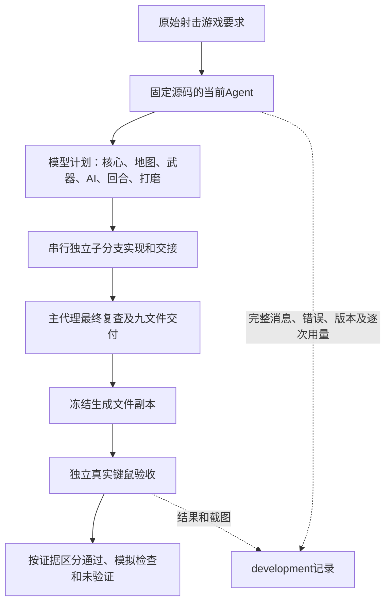

# 射击游戏大任务复测：2026-10-28

本轮只验收，不修改Agent运行源码、不替模型改游戏。建议下一轮优先补齐连续原生键鼠工具、子代理基础交接能力，以及验证报告的证据范围；不要增加另一层审查模型或重复检查。

## 两个关注点的结论

| 关注点 | 已有实际证据 | 尚未证明或暴露的问题 |
| --- | --- | --- |
| 任务分配与最后组装 | 模型制定六个实现任务并逐个委派独立分支；相关模块交接确实进入请求；主代理进行最终复查并登记九个文件；独立真实键鼠操作和单回合战斗通过 | 子任务共同反复修改main.js；计划contracts为空，六个子任务工具清单都不含history_read/task_checkpoint，结构化接口和未完成项均未使用；最终还有回合/比赛结束层重叠，不能说整合完整或新接口契约已验证 |
| 出错后定位、修正、确认 | 两次原始页面启动错误被回传，模型修改后新文档不再出现；回合停滞通过实际等待复查，修改后进入下一回合；独立副本真实射击造成敌人伤害/击杀，玩家自然战败后R重开成功 | 运行中的大部分战斗/整场测试直接调用扣血或推进回合，不能作为真实玩法通过；主代理最终报告对“已实际验证”范围表述过宽；有限止损机制没有触发，不能据此宣布所有绕圈问题已解决 |

这次可说Agent独立交付了一个可操作、可战斗和重开的原型，不能说达到了CSGO质量目标，也不能据一次成功推广为任意大任务都可靠。

## 测试隔离与实际过程

- 新工作区：`E:\game\retry-20261028`，从空白开始；上一轮`E:\game`中的18个原工作文件逐一核对，哈希未变，原历史也未清理。
- 完整测试现场：`development/records/evals/fps-retry-20261028-01/`。入口沿用`evaluate_tactical_fps.py`，只增加兼容的`--workspace`可选参数；原默认目录不变。原大任务文本只替换工作区路径，没有删掉质量、功能或如实报告要求。
- Agent运行期间冻结所有`src/`文件；结束核对全部哈希无变化。没有开发者修改游戏、反馈验收答案、重载模型或调用云端收费模型。
- 本地已加载`qwen/qwen3.8-27b`，Q4_K_M，实际加载上下文100096，输出上限16384，温度0.1，reasoning none；只为本次评估把整轮超时设为3600秒，没有改保存设置。
- 原生模型元信息首次未带认证返回401，使用已有本地认证后200；这是验收脚本查询过程，记录在loaded-model.json，不是Agent任务故障。

### 本轮解释图



这里没有在Agent之外增加自动修复者；独立验收在模型运行结束后才开始，不会把答案送回模型。这一轮不因发现问题自动改Agent再重试。

## 实际任务分配和成本

| 子任务 | 分配职责 | 模型调用 | 秒 | 收到前序交接数 |
| --- | --- | ---: | ---: | ---: |
| core | 入口、配置、音频、最小主循环 | 19 | 159.469 | 0 |
| map | 地图与主循环接入 | 27 | 242.610 | 1 |
| weapons | 武器与主循环接入 | 46 | 288.375 | 2 |
| ai | AI与主循环接入 | 30 | 217.109 | 3 |
| rounds | 回合与主循环接入 | 66 | 378.984 | 4 |
| polish | 界面、最终整合和说明 | 46 | 481.078 | 5 |

主代理另有57次调用，整轮291次、2149.781秒，正常finished，没有人工停止或开发者接管。finished只是模型正常结束，本身不等于验收通过。

共服务上报输入10152735、输出95066token，291条逐次usage完整，未知0条。输入为跨请求累计，不能当单个上下文长度或未缓存收费量。最大单次实报输入67144；本轮没有90%压缩或输出截断事件，不能用这次测试证明窗口极限续跑。

29条输出>=512 token且流式跨度>=2秒的调用，合并输出/合并流式跨度约67.03 token/s，中位69.324；这是被动SSE近似，不是GPU内核吞吐。425个整机采样中GPU利用率中位91%，显存峰23530MiB，RAM峰98.6%；其他进程未控制，不作因果性能结论。

### 交接到底用了什么

地图实际收到核心交接；武器实际收到核心和地图交接，其中核心的共享主文件被正确标为过时，地图对应当前版本。后续AI、回合和打磨分别收到3、4、5份依赖或共享文件交接。完整请求在各child报告，摘要在evidence-index.json。

所有六次handoff的interface_source都是none，unresolved都是空数组；不是证明“没有待办”，而是子任务没提供结构化声明。主代理最后使用过一次工作断点，不能替代子任务接口交接。工具选择机制允许模型把基础历史/断点工具排除，导致原文坐标虽在回执里，子任务却没有history_read能力取回全文。

main.js累计写入/编辑32次，六个子任务均可能修改此文件；地图和回合的接入均出现实际启动错误。没有并行写冲突，但这个共享入口是集成成本集中点。子任务文件读取共83次，其中回合26次；分页及定位含合理读取，不能把所有读取都定性为浪费。

## 可核对的错误与修正链

| 事件 | 模型采取的动作 | 实际确认范围 |
| --- | --- | --- |
| 352：main.js:60，读取undefined.build | 先尝试改未分配的index被拒绝；371/393修改获准的main.js，等待地图脚本加载后初始化 | 405重新打开，407回执document=4/errors=[]；后续独立浏览器启动也无运行异常 |
| 1746：main.js:348，读取undefined.appendChild | 读取对应源码、1775修改main.js，1787重新导航并开始游戏 | 后续页面错误没有再次出现；独立副本启动通过 |
| 1962之后回合停滞 | 触发内部回合结束、实际等待5秒后仍停第一回合；2004/2016/2038调整主循环中的回合更新 | 2094再次触发后实际等待，2116返回round=2、phase=buy；这是状态机集成复查，不是玩家开枪获胜 |
| 2564：检查脚本取style.opacity出错 | 改用实际存在的方向指示元素读取 | 当时页面diagnostics为空；这是检查脚本错误，不算修好了一个游戏故障 |

最初四次FileNotFound是核心子代理在空目录读尚未创建文件，随后创建成功，原失败保留。重复失败阻止、停滞诊断和暂停事件均未触发；本轮没有证据说明它们的边界在此场景已被充分检验。

## 独立验收

全部使用新Edge、冻结副本和真实Playwright键鼠输入，副本和原工作文件哈希一致；只读公开状态。没有设置生命、位置、计时或比分，没有调用enemyHit/endRound等函数。战斗瞄准脚本会读取包括遮挡目标在内的敌人坐标，不是人类游玩或公平竞技平衡证明。

| 验收组 | 结果 |
| --- | --- |
| independent-controls | 启动、声音开关、开始、Pointer Lock、真实W移动、鼠标瞄准、射击耗弹、R换弹、1-4切枪、无页面异常均通过 |
| independent-combat | 真实射击造成敌人伤害和击杀；玩家自然HP=0、T得分；R重开回到HP100、正常playing；无页面异常，全部检查通过 |
| independent-match | 原生自动游玩249个操作步，八轮自然战败至CT 0:T 8，DEFEAT与gameOver实际出现；M回菜单，再点击START GAME后第1回合、0:0、HP100；无页面异常。CT自然获胜检查未覆盖，不能记为通过 |
| 独立截图视觉复核 | 发现比赛结束时TERRORISTS WIN与DEFEAT两层文字重叠，见independent-match/game-over.png；game_over_text也同时含回合与整场提示。是实际呈现问题，不是异常或验收脚本失败；没有替模型修正 |

完整比赛测试有360秒上限，达到自然结束后停止；没有重放同一个检查来凑通过。native_ct_round_win=false表示本轮原生自动游玩没有覆盖到CT胜，并不单独证明CT无法获胜。Agent的CT胜/8胜检查仍只属于内部函数与状态机测试，独立结果不替其扩大验证范围。炸弹安放/拆除、全路线碰撞/攀爬、公平竞技和声音主观效果也未完整独立验收。

Agent和独立自动状态检查都没有以异常形式发现结束层重叠，开发者查看真实截图才确认。回合结束和比赛结束两套UI的互斥清理仍有缺口；功能路径通过不代表视觉呈现通过。本轮只记录该问题，没有修改原游戏去制造全部通过。

独立场景观测102个mesh、92种geometry、6个纹理，相机在场景内。实际截图是低精度几何武器和程序化贴图场景，不能称为CSGO级画面。Agent自己的README也列出无联机、无购买菜单/投掷物、无角色动画、基础AI，楼梯仅视觉、不支持实际攀爬等差距。完整质量目标未通过。

游戏交付文件职责：

```text
E:\game\retry-20261028/
├── index.html          入口、菜单/HUD样式、显式加载模块
├── js/
│   ├── config.js       地图、武器和回合配置
│   ├── audio.js        程序化音效及声音开关
│   ├── map.js          地图几何、纹理、区域与碰撞数据
│   ├── weapons.js      武器视图、弹药、换弹、扩散与切换
│   ├── ai.js           敌人、行为、受伤/死亡和攻击
│   ├── rounds.js       回合、比分、炸弹及比赛结束
│   └── main.js         控制、渲染、射击、HUD与模块组装
├── README.md           模型写的说明和验证声明，须与独立证据分开
├── browser-captures/   模型保存的截图
└── .clearact/          原始消息/事件、六个子分支、写前快照、完整浏览器错误
```

## 下一步建议，尚未实施

1. **让基础交接能力始终可用。** 将历史读取/工作断点与可选执行工具区分，避免模型选浏览器工具时顺手丢掉结构化交接能力；明确接口提供者、消费者和加载/挂接点，减少多个子任务轮流改共享入口。不要通过强制重读全部文件来替代交接。
2. **补原生连续键鼠工具。** 当前浏览器只有click/press/hover等，没有keydown/up、mousemove、mousedown/up的连续输入能力；这限制了Agent自己验证交互任务的能力。新增能力应复用BrowserPort和既有日志/停止/超时，不增加额外检查模型。
3. **把证据范围写清楚。** 内部函数、强制状态测试和用户真实交互应分别表述；主代理复用有效证据，只补需求相关的缺口。不能因为直接扣血成功，就宣布真实瞄准击杀已验证；也不必重复已通过的相同检查。

当前完整维护文件树见[本轮树](2026-10-28-fps-retry-tree.txt)，当前模块职责未改变，见[架构总览](../ARCHITECTURE.md)。原始运行、失败、用量与截图全部留在本轮records，没有上传私有数据。
