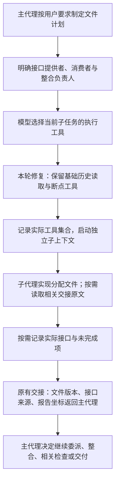

# 子代理基础交接修复：2026-11-08

本轮解决显式工具清单会丢掉历史读取和断点能力的问题，并补充模型分工说明。完整回归87项通过；本地模型恢复后，三模块真实任务和独立浏览器验收通过，133.516秒、39次调用。这是有限范围的多文件交接验证，不能宣布大型任务可靠性已验证，也不把上一版的真实游戏成绩计入本轮。

## 原因、修改与影响

上一轮FPS中六个子任务的显式tools都没有history_read/task_checkpoint，覆盖默认集合后，已有原文坐标和结构化交接路径实际不可用。这不等于模型主动判断“不需要待办”，也不能靠重复读取整个工作区替代。

| 板块 | 本轮修改 | 边界 |
| --- | --- | --- |
| runtime/delegation.py | 分开基础交接工具与默认执行工具，实际集合为选择的执行工具＋history_read/task_checkpoint | 显式空数组仍没有可选执行工具；不自动加入文件、浏览器或MCP能力 |
| task.assignment事件 | 新增effective_tools，保留模型原来的task.tools | 可以对照原计划与实际工具；旧历史不改写 |
| tools/tasks.py | 说明tools新语义，建议明确接口提供者/消费者和共享入口整合负责人 | 模型仍决定计划、接口声明、文件安排和检查；不强制填接口、不增加审查模型 |
| development/tests/test_handoffs.py | 增加五个回归场景 | 真实Runner/存储＋模型协议替身，不能算真实模型验收 |
| development/scripts/verify_delegation_handoff.py | 新增离线购物计价三模块本地模型验收入口 | 指定执行工具不含基础工具，观察实际接口交接；生成结束后独立Edge验证；生产运行不加载脚本 |
| development/docs | 更新统一契约、规则、实际完整文件树及本图 | 历史图和旧现场保持原内容；补回当前架构树之前漏列的development/README.md |

不新增运行模块、工具名称、公共DTO或Application/Port签名。接口、文件SHA、未完成项、原文坐标继续使用既有TaskHandoff等结构；schema_version仍为1。显式tools现在不能移除两项基础交接工具，契约文档明确这一行为变化。

## 本轮解释图



图中B、F、G、I是同一模型正常工作中的选择，不是新增强制模型轮次。D只合并工具集合；E只增加日志字段。历史访问仍限本分支、自己委派的子分支或明确交接来源；文件写入仍受分配路径限制。没有让子代理读取任意父/兄弟分支。

## 验证与失败保留

回归现场在`development/records/evals/handoff-baseline-20261108-01/`：修改前快照、协议替身回归、首次接口不可用及验证记录均留存。模型恢复后的真实任务在`development/records/evals/handoff-baseline-20261108-real-02/`，两次现场分开保留，不含在上传的维护文件中。

- 针对性交接/长任务回归：22项通过，1.62秒。禁用pytest缓存插件后存在一项cache_dir配置提示，不是用例失败。
- 最终完整回归：87项通过，13.23秒。Windows开发缓存目录写入产生两项警告，用例通过；没有为消除缓存提示重复运行完整回归。
- Ruff：首次报一条新Schema说明文字超过120列；缩短说明后最终全部通过。未因这一纯描述修改重复运行完整回归。
- 新增的五个场景包括省略tools、显式null、空数组、只选browser_read，以及只选file_write时两个子代理完成接口断点和交接原文读取。最后场景生产Runner实际执行了history_read，原文中间被短报告省略的内容仍能取回。
- 原有历史权限、错误任务接口声明、旧计划兼容、文件版本失效和“后续失败覆盖早先成功”等回归仍通过。测试约束实际模型请求次数，没有新增自动审查或自动断点调用。
- 本地配置为qwen/qwen3.8-27b，容量100096、输出16384。首次普通探测返回HTTP502，绕过环境代理的直接loopback连接为ConnectError；首次真实入口记录model_unavailable、real_model_calls=0。用户随后明确告知服务已启动，才新建目录重新运行。没有替用户重载模型、修改保存配置、调用云模型或持续轮询。

首次连接失败是模型服务/连接不可用，不是游戏或交接实现运行失败。该次0仅表示没有发起模型生成，不能写成任务以0token完成；后续真实生成用量单独记录如下。

## 真实三模块结果

任务为catalog.js（数据）、quote.js（整数分计价）和index.html（入口整合）。为聚焦复现工具过滤缺陷，测试任务明确要求这三项职责、三个限定文件及显式执行工具清单；不能用本轮证明模型会在任意需求中自行做出最佳拆分。

| 实现任务 | 实际调用/秒 | 已观察交接与写入 |
| --- | --- | --- |
| catalog | 5 / 12.281 | catalog.js写入1次，实际CATALOG接口断点1次，未完成项空 |
| quote | 4 / 16.453 | quote.js写入1次，实际computeQuote接口断点1次，未完成项空 |
| ui | 5 / 30.610 | 收到两个依赖交接，index.html写入1次，消费两个实际接口；明确保留“本子任务无浏览器工具，父代理需验收”的未完成项 |

三个子代理都只选择file_read/file_write/file_edit，实际工具集合均精确为这三项加history_read/task_checkpoint。没有额外执行工具。三次handoff.interface_source=checkpoint；UI收到的实际接口、文件版本和待办来自现有交接结构，三个实现模块没有反复改同一共享入口。

模型这次没有填写计划可选contracts（仍为空），也没有调用history_read。真实结果证明了基础工具保留、实际接口断点和后继消费交接，不证明模型已自然使用命名计划契约或按原文坐标取回报告；原文读取由本轮真实Runner＋协议替身回归覆盖。

主代理另有25次模型调用，执行整合和浏览器检查，登记三个文件并保存断点。全程39次、133.516秒；服务逐次上报输入430750、输出6117token，39条usage完整，未知0条。输入是跨请求累计，不是独立上下文长度或未缓存计费量。本轮没有做同任务旧版/新版性能对照，不能声称已降低总token或达到最优参数。

两次FileNotFoundError来自catalog/quote在空工作区读取尚未创建的自身文件，随后各自写入成功；失败保留。没有开发者改生成文件或向运行中的模型注入独立验收结果，源码哈希核对未变。没有容量归档、输出续跑或补救预算暂停事件，本轮不证明这些边界。

独立Edge在生成结束后打开冻结源码所生成的页面：

- 六个局部计价样本通过：空车、数量全零、单件、三件折扣、满额免运费、小额按分舍入。它们是函数级检查。
- 真实选择书、输入3、点击添加，DOM显示小计37.50、优惠3.75、税4.39、运费5.99、总额44.13，购物行实际出现；真实点击清空后五项均0.00。这些是原生DOM操作。
- 无页面脚本异常；实际查看独立截图，页面可读、控件及金额展示正常。截图只覆盖这一简单桌面场景，不扩展为移动端或复杂视觉验收。

完整父子消息、原始调用与逐次用量、assignments.json、independent.json/independent.png、源码哈希均保留。后处理evidence-audit.json还验证实际工具集合与显式清单的精确关系。验收入口在运行后收紧了“必须显式选择＋无额外执行工具”的判据，用原始assignments离线复核通过，未重跑模型；实际运行脚本SHA与修改前副本另存，不把后处理说成第二次真实运行。

复用入口时record必须是尚不存在的新目录；任务结束后独立检查不会反馈或自动修复：

```powershell
$env:PYTHONPATH = 'src;development/scripts'
$env:PYTHONUTF8 = '1'
$env:NO_PROXY = 'localhost,127.0.0.1,::1'
python development/scripts/verify_delegation_handoff.py --record development/records/evals/handoff-baseline-<新批次>
```

## 建议与未验证范围

建议下一轮选一个新的复杂任务，观察模型自主分工、交接和最后组装是否仍然有效。先保留当前这批修复，再用实际失败决定下一步，不增加无条件审查轮次。仅仅保留工具不能保证合理分工或使用结构化计划；这两项仍需要更大范围观察。

本轮没有改浏览器连续键鼠能力、截图模型输入或补救预算，没有修复之前游戏结束层重叠。当前完整维护树见[本轮树](2026-11-08-handoff-baseline-tree.txt)，主流程和模块总表见[架构总览](../ARCHITECTURE.md)。未提交或推送本轮修改。
