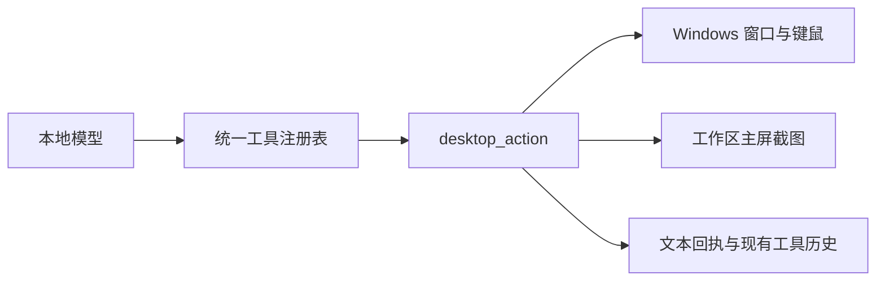

# Windows 桌面工具原型

原型仅在 Windows 且启动环境设置 CLEARACT_DESKTOP=1 时注册。操作使用当前 Windows 会话，点击和输入会作用到真实前台窗口。第一版支持窗口列表、聚焦、主屏截图、鼠标移动和左键、按键组合及可打印 ASCII 输入。



模型收到窗口标题、坐标和截图路径。图像未接入模型请求，桌面控件语义读取也尚未实现。Windows 可能拒绝前台切换，工具会回报失败。截图位于工作区 desktop-captures，Git 默认忽略。

```powershell
python -m pip install -e ".[desktop]"
$env:CLEARACT_DESKTOP = '1'
.\clearact.cmd
```

隔离测试窗实测已枚举窗口并保存主屏 PNG。首次聚焦触发 Windows 错误，后续一次捕获截图但未收到预期文字，另一次仍被前台切换拦截。键鼠联动和模型自主操作未经完整验收。原始失败与截图保存在 development/records/desktop-20261119。本轮已有 87 项回归通过。
